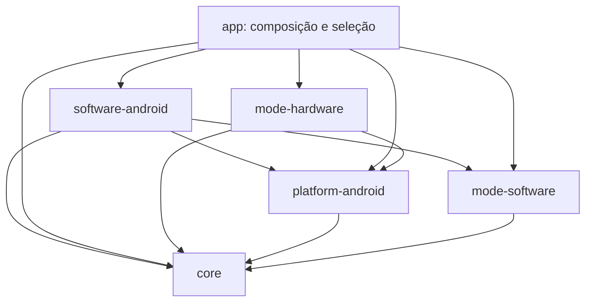

# Desenvolvimento paralelo: hardware e software

## Dependências



O módulo software usa os óculos por contratos injetados pelo app; não precisa
importar Android ou Meta DAT. Isso permite testar seu domínio apenas com JDK 17.
A integração `GlassesFrameSource` adapta o gerenciador DAT ao contrato comum
`FrameSource`; a captura usa a sessão Meta DAT real, ainda não validada com os óculos.

## Divisão de trabalho

| Diretório | Responsabilidade | Quem altera normalmente |
|---|---|---|
| `android/software-android/` | Interface e áudio do tutor CAD | Equipe software |
| `android/mode-software/` | Desenho técnico, conversa, planejamento e avaliação CAD | Equipe software |
| `android/mode-hardware/`, `ml/` | Montagem física, detectores, procedimentos e checkpoints físicos | Equipe hardware |
| `android/core/` | Contratos de imagem/áudio, objetivos e resultados | Mudanças coordenadas |
| `android/platform-android/` | Meta DAT, áudio Android, qualidade da captura e conexão | Integração compartilhada |
| `android/app/` | Composição das implementações e interface companion | Integração compartilhada |

Os modos não dependem um do outro. O núcleo não conhece classes de peças,
operações Fusion ou SDKs de modelos. Não ampliar o Room legado para CAD por
acidente: ele descreve a sessão física. Persistência CAD deve ser definida no
respectivo modo e só generalizada quando houver requisitos comuns reais.

## Contratos iniciais

- `ImageFrame`: bytes codificados, MIME, origem e timestamp. DAT deve entregar JPEG
  no adaptador atual. Não passar pixels crus fingindo que são JPEG.
- `PcmAudioChunk`: PCM signed 16-bit little-endian, taxa e canais explícitos.
- `FrameSource`: captura utilizável ou `null`; ambos os modos podem usar óculos.
- `TutoringPlan` / `TutoringGoal`: objetivos, sem vínculo com detecção de peças.
- `GoalAssessment` / `StepResult`: evidência de correto, erro ou inconclusivo.
- `SoftwareTutorProvider`: adaptador do modelo; entrada/saída incremental de áudio
  e texto. A saída não substitui o estado de progresso mantido pela aplicação.

O motor e fading legados continuam no hardware: sua lógica depende de classes
visuais. Não foram artificialmente generalizados para modelagem CAD.

## Verificação independente

```bash
# Raiz do repositório: sem dependências extras
python3 scripts/check_module_boundaries.py

# android/: somente JDK 17+ (sem SDK Android ou credenciais)
./gradlew -p jvm-tests :core:test :mode-software:test

# android/: JDK 17+ e SDK Android 36
./gradlew assembleDebug testDebugUnitTest :mode-hardware:assembleDebugAndroidTest
```

O build `jvm-tests` aponta para os mesmos diretórios dos módulos e usa o mesmo
catálogo `gradle/libs.versions.toml`, sem duplicar código ou versões. Evitar
executar os dois builds Gradle simultaneamente no mesmo checkout, pois
compartilham as saídas desses módulos. O script de fronteiras confere imports
entre módulos, declarações duplicadas em pacotes compartilhados e dependências
Gradle diretas; o compilador é a verificação definitiva. O CI do GitHub Actions
roda os três comandos.

## Integração das branches da final (outubro/2026)

As branches abertas antes e durante a final foram integradas em `develop`:

| Branch | Como entrou |
|---|---|
| `fix/ml-requirements-tensorflow` | Merge direto (já estava na estrutura modular), com os conflitos semânticos corrigidos. |
| `feature/ajustes-mentoria` | `augment.py` e o fechamento da câmera logo após a captura, aplicados nos novos caminhos. |
| `prep/final-2026-09-18` | Motor de decisão, procedimento da torneira, classificador v1, pipeline de ML, testes e registros portados para os módulos. Fotos de diagnóstico e o modelo smoke de 11 MB ficaram fora do Git. |
| `docs/lgpd-privacidade`, `feature/scaffold-inicial` | Já estavam contidas no histórico. |

Regras que continuam valendo para novas branches:

1. Cada equipe trabalha nos diretórios da tabela; combinar alterações dos contratos.
2. Ao trazer código anterior à reorganização, aplicar os edits nos novos caminhos;
   não recriar `app/src/main/java/com/stepwise/vision`, `engine`, `audio`, etc.
3. Dependências específicas ficam no Gradle do módulo e a versão no catálogo,
   não em `app/build.gradle.kts`.
4. Não declarar classes no pacote de outro módulo (ex.: `com.stepwise.software`
   fora do `:mode-software`): o script de fronteiras acusa.

## Estado real após a integração

Hardware: sessão com voz offline, captura Meta DAT (compilada contra o SDK 0.9.0,
ainda não validada com os óculos), classificador local, motor determinístico com
abstenção, checkpoints no Room e avaliação opcional pela Groq. O guia manual
continua disponível sem óculos.

Software: tutor Gemini Live (testado com servidor simulado; sessão real exige
token e validação no aparelho) e passo a passo narrado pela Groq.
Veja o [roteiro do primeiro fluxo](modo-software-primeiro-fluxo.md).

A arquitetura física anterior está em `architecture-stepwise.mmd`. A
[política de privacidade](lgpd-privacidade.md) é específica do hardware; o fluxo
de dados do software está documentado no roteiro acima.
