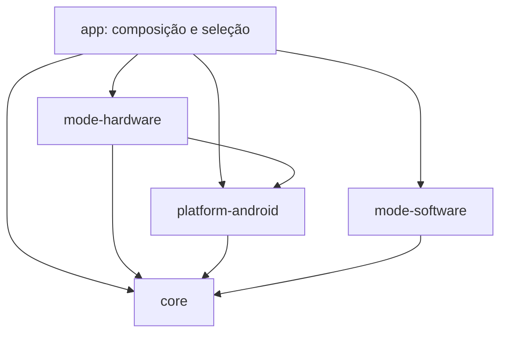

# Desenvolvimento paralelo: hardware e software

## Dependências



O módulo software usa os óculos por contratos injetados pelo app; não precisa
importar Android ou Meta DAT. Isso permite testar seu domínio apenas com JDK 17.
A integração `GlassesFrameSource` adapta o gerenciador DAT ao contrato comum
`FrameSource`. A captura DAT ainda lança `NotImplementedError` neste checkout.

## Divisão de trabalho

| Diretório | Responsabilidade | Quem altera normalmente |
|---|---|---|
| `android/mode-software/` | Desenho técnico, conversa, planejamento e avaliação CAD | Equipe software |
| `android/mode-hardware/`, `ml/` | Montagem física, detectores, procedimentos e checkpoints físicos | Equipe hardware |
| `android/core/` | Contratos de imagem/áudio, objetivos e resultados | Mudanças coordenadas |
| `android/platform-android/` | Meta DAT, áudio Android, qualidade da captura e conexão | Integração compartilhada |
| `android/app/` | Composição das implementações e interface companion | Integração compartilhada |

Os modos não dependem um do outro. O núcleo não conhece classes de peças,
operações Fusion ou SDKs de modelos. Não ampliar o Room legado para CAD por
acidente: ele descreve a sessão física. Persistência CAD deve ser definida no
respectivo modo e só generalizada quando houver requisitos comuns reais.

## Contratos iniciais

- `ImageFrame`: bytes codificados, MIME, origem e timestamp. DAT deve entregar JPEG
  no adaptador atual. Não passar pixels crus fingindo que são JPEG.
- `PcmAudioChunk`: PCM signed 16-bit little-endian, taxa e canais explícitos.
- `FrameSource`: captura utilizável ou `null`; ambos os modos podem usar óculos.
- `TutoringPlan` / `TutoringGoal`: objetivos, sem vínculo com detecção de peças.
- `GoalAssessment` / `StepResult`: evidência de correto, erro ou inconclusivo.
- `SoftwareTutorProvider`: adaptador do modelo; entrada/saída incremental de áudio
  e texto. A saída não substitui o estado de progresso mantido pela aplicação.

O motor e fading legados continuam no hardware: sua lógica depende de classes
visuais. Não foram artificialmente generalizados para modelagem CAD.

## Verificação independente

```bash
# Raiz do repositório: sem dependências extras
python3 scripts/check_module_boundaries.py

# android/: somente JDK 17 (sem SDK Android ou credenciais)
./gradlew -p jvm-tests :mode-software:test

# android/: JDK 17 + SDK Android 34
./gradlew :mode-hardware:testDebugUnitTest :platform-android:testDebugUnitTest :app:assembleDebug
```

O build `jvm-tests` aponta para os mesmos diretórios dos módulos, sem duplicar
código. Evitar executar os dois builds Gradle simultaneamente no mesmo checkout,
pois compartilham as saídas desses módulos. O script de fronteiras confere imports
entre módulos e dependências Gradle diretas; o compilador é a verificação definitiva.

## Integração de branches em andamento

1. Integrar esta mudança estrutural antes de iniciar novas features nos dois modos.
2. Cada equipe trabalha nos diretórios da tabela; combinar alterações dos contratos.
3. Preservamos packages Kotlin antigos para reduzir alterações de imports.
4. Ao integrar commits anteriores à mudança, aplicar os edits nos novos caminhos;
   não recriar `app/src/main/java/com/stepwise/vision`, `engine`, `audio`, etc.
5. Classes, testes e assets foram movidos juntos. Dependências específicas devem
   ficar no Gradle do seu módulo, não em `app/build.gradle.kts`.

## Estado real após a reorganização

A interface permite selecionar hardware/software e informa que as sessões ainda
estão em desenvolvimento. Não conecta provedores nem inicia captura. O modo
software tem contratos, orquestração mínima e testes falsos; não é um tutor CAD
pronto. A implementação hardware deste checkout continua com seus TODOs.

A arquitetura física anterior está em `architecture-stepwise.mmd`. A política
legada de privacidade é específica do hardware; antes de integrar um provedor
remoto no software, documentar os fluxos reais de imagem e áudio desse modo.
