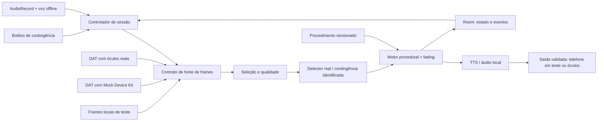

# StepWise — plano de ação para a final

**Data-base:** 15/09/2026 · **Evento:** 18/09/2026 · **Versão:** 1.0

**Objetivo:** chegar com o aplicativo, a IA, o procedimento, o áudio, a persistência e a demonstração preparados e testados; usar o evento para parear os Ray-Ban Meta, validar as rotas reais, calibrar a percepção e medir o conjunto.

**Estado deste arquivo:** plano em execução. Em 16/09/2026, APK debug compilado, instalado e aberto no POCO; 1 teste unitário e build offline aprovados. Tela mínima e estado autorizado das permissões conferidos. DAT resolvido como dependência; conexão com óculos, IA e voz ainda não validadas.

## Onde estamos e qual é o próximo passo

**Concluído: A01, B01 e B05.** POCO X8 Pro Max conectado e autorizado: Android **16**, API **36**, build `BP2A.250605.031.A3` e ABI **`arm64-v8a`**, confirmados por ADB. HyperOS `3.0.303.0.WPLMIXM.C11`, RAM física de 12 GB, 146,3 GB livres e Meta AI instalado foram informados pelo usuário.

Notebook do evento: Lenovo `80YF`, aproximadamente 8 GB de RAM, Windows 11 Pro. SDK 36, Build-Tools 36.0.0, Gradle 8.14.1 e JDK 17 validados por compilação. Studio mantém JBR 21 para a IDE; sua sincronização pela interface ainda não foi observada. O [inventário do ambiente](ambiente-validado.md) contém caminhos e evidências.

**B02, B04 e B06–B20 concluídas.** CameraAccess e sessão simulada MDK testados; Room com 2 testes aprovados. B08: login e Developer Mode Meta AI confirmados pelo usuário, roteiro offline em [meta-ai-registro-real.md](meta-ai-registro-real.md). B15/B16: Python 3.10.11 x64 local e `.venv-tools` validados; Python 3.14 global preservado. B17/B18/B19: Ubuntu WSL2, Python 3.10.21 via `uv`, Model Maker e treino/exportação smoke `.tflite` validados; detalhes em [b17-b19-treino-exportacao.md](b17-b19-treino-exportacao.md). B20: POCO executou inferência sintética com TensorFlow Lite Interpreter e validou saídas de boxes/classes/scores/count. Em 17/09/2026, o kit real foi ajustado para uma montagem com torneira/conexões, e o dataset `dataset stepwise/` foi padronizado com 581 imagens. Manifesto e splits foram gerados em `ml/data/stepwise_real/`; detalhes em [dataset-real-stepwise.md](dataset-real-stepwise.md). Registro real, pareamento e vídeo dos óculos permanecem pendentes de hardware. Arquivos ainda sem commit. **E15–E17 concluídos tecnicamente:** primeiro classificador real treinado, exportado e validado no POCO com imagens reais. E20/E21 confirmaram que a qualidade atual é insuficiente para avanço automático. C01/C04/C06–C10 e D02–D06 foram implementados para decisão conservadora. Motor ligado à tela em modo demo/controlado e instalado no POCO. Próximo passo: preparar fonte local de imagens/diagnóstico ou iniciar áudio/TTS, antes do DAT real. B21/B22 continuam úteis para congelamento, mas não devem atrasar o refinamento do modelo real.

**Limite da validação:** tela de preparação e operações básicas Room testadas; sessão DAT, detector, voz, migrações do banco, recuperação após morte do processo e acompanhamento da montagem ainda não validados.

## Navegação

**Execução acelerada:** seguir [execução em blocos](execucao-em-blocos.md), preservando os critérios individuais abaixo.

- [1. Estratégia e critérios de prontidão](#1-estratégia-e-critérios-de-prontidão)
- [2. O que manter e o que mudar](#2-o-que-manter-e-o-que-mudar)
- [3. Stack e decisões técnicas](#3-stack-e-decisões-técnicas)
- [4. Organização da execução](#4-organização-da-execução)
- [5. Fase A — kit, escopo e decisões](#5-fase-a--kit-escopo-e-decisões)
- [6. Fase B — ambiente e build](#6-fase-b--ambiente-e-build)
- [7. Fase C — contratos e procedimento](#7-fase-c--contratos-e-procedimento)
- [8. Fase D — motor, adaptação e dados](#8-fase-d--motor-adaptação-e-dados)
- [9. Fase E — visão e treinamento](#9-fase-e--visão-e-treinamento)
- [10. Fase F — áudio e comandos](#10-fase-f--áudio-e-comandos)
- [11. Fase G — DAT e fontes de imagem](#11-fase-g--dat-e-fontes-de-imagem)
- [12. Fase H — integração e testes](#12-fase-h--integração-e-testes)
- [13. Fase I — evidências e pacote de viagem](#13-fase-i--evidências-e-pacote-de-viagem)
- [14. Runbook do evento](#14-runbook-do-evento)
- [15. Planos B e limites](#15-planos-b-e-limites)
- [16. Checklist de saída e decisões para mentoria](#16-checklist-de-saída-e-decisões-para-mentoria)
- [17. Fontes e autoridade das decisões](#17-fontes-e-autoridade-das-decisões)

## 1. Estratégia e critérios de prontidão

### 1.1 O que precisa estar pronto antes do evento

1. APK instalável no celular-alvo, com modelos e voz disponíveis sem download.
2. Seis etapas de um único kit real descritas em uma configuração canônica.
3. IA real executando no celular, com avaliação em dados separados do treinamento.
4. Motor que distingue `CORRECT`, `KNOWN_ERROR` e `INCONCLUSIVE`.
5. Instruções por áudio e comandos em português, com botão de contingência.
6. Fading por etapa, histórico persistente e cenário demonstrativo identificável.
7. Adaptador DAT compilado e exercitado com Mock Device Kit (MDK).
8. Caminho integrado com imagens reais do kit, recebido por fonte de desenvolvimento, e pelo MDK.
9. Tela técnica que identifica fonte de imagem, rota de áudio, modelo, etapa e falhas.
10. Roteiro de demo, vídeo prévio identificado como teste sem óculos, folha de privacidade e ferramentas de medição.

**Só deve ficar para o hardware:** pareamento/autorizações do dispositivo disponibilizado, confirmação do microfone e alto-falantes reais, qualidade e atraso dos frames, coexistência HFP/câmera, autonomia de bateria e calibração final.

O MDK reduz o trabalho de integração, mas não prova Bluetooth, perspectiva óptica, bateria, latência de transmissão ou roteamento acústico. Não prometer que o evento exigirá apenas um clique.

### 1.2 Marcos de liberação

| Marco | Evidência para considerar concluído |
|---|---|
| G0 — hardware e kit definidos | Celular identificado; seis estados físicos fotografados; erros reproduzíveis. |
| G1 — ambiente reproduzível | APK compilado/instalado; exemplo DAT abre; IA de referência executa; versões registradas. |
| G2 — núcleo independente dos óculos | Procedimento, motor, fading, Room e TTS funcionam com entradas controladas. |
| G3 — percepção real no celular | Modelo próprio ou contingência explicitada; teste com kit real; voz offline testada. |
| G4 — integração pré-evento | Mesmo controlador funciona com MDK e fonte local; falhas não avançam etapa; cinco ciclos completos. |
| G5 — pacote congelado | APK, modelos, dependências, documentação, backup e ensaio disponíveis offline. |
| G6 — integração real | Entrada e saída nos óculos; IA real; caso correto, erro e inconclusivo; vídeo gravado. |
| G7 — apresentação | Fading audível, medidas reais e cinco checkpoints demonstráveis. |

**Não confundir:** frames gravados do kit processados por um modelo real são teste de integração; resultados predefinidos são simulação. Na demonstração final, identificar a origem real de cada evidência.

## 2. O que manter e o que mudar

### 2.1 Diagnóstico da base atual

O repositório já expressa a arquitetura, mas os principais caminhos estão incompletos. `capturePhoto()` e o carregador de procedimentos lançam `NotImplementedError`; o detector retorna vazio; o Quality Gate sempre aceita; a fala está comentada; UI e controlador não executam o fluxo. Há estrutura Room e uma redução básica de assistência, ainda sem integração completa.

Também não foram encontrados Gradle Wrapper, modelo `.tflite` ou dataset anotado. O manifesto referencia `@mipmap/ic_launcher`, recurso ausente na árvore examinada. Nesta sessão, `python` resolveu para **3.14.7**; `git`, `adb` e `gradle` não estavam no PATH. Isso não prova que estejam ausentes da máquina; primeiro localizar instalações existentes.

### 2.2 Matriz de reaproveitamento

| Arquivo/área | Decisão | Alteração concreta planejada |
|---|---|---|
| `android/`, Kotlin, applicationId `com.stepwise` | Manter | Aplicativo nativo e estrutura simples. |
| `MainActivity.kt`, AppCompat | Completar | Uma tela com iniciar, verificar, ajuda, repetir, encerrar e diagnóstico. XML/ViewBinding; sem migração de UI necessária. |
| Gradle raiz/app/settings | Atualizar | Matriz compatível, Wrapper, catálogo de versões, DAT real, dependências fixas. |
| `minSdk = 26` | Rever | Adotar API 31 para a rota inicial baseada no exemplo DAT atual; verificar aparelho antes. |
| `.env.example` | Corrigir | Remover pressuposto de `META_DAT_API_KEY`; usar configuração realmente exigida pelo SDK. `.env` não é lido automaticamente pelo Gradle. |
| `local.properties.example` | Atualizar | Caminho Windows válido do SDK; parâmetros locais realmente utilizados. |
| `Procedure.kt`, JSON, loader | Manter conceito; reformular dados | Versão, regras espaciais, evidência, erros e instruções unificados ao kit real. |
| `ProceduralEngine.kt` | Reimplementar avaliação | Motor puro, sem Android; resultado com motivo; estado e efeitos explícitos. |
| `FadingPolicy.kt` | Ampliar | Domínio por etapa/repetição; ajuda, erros repetidos e inconclusivo tratados corretamente. |
| `DetectionResult.kt` | Ampliar | Origem, tempo, qualidade e versão; coordenadas e rótulos com contrato único. |
| `VisualDetector.kt` | Manter interface conceitual | Implementar modelo local real e uma contingência selecionável. |
| `MetaDatSessionManager.kt` | Substituir implementação | Fonte de frames de stream; `capturePhoto()` somente como opção testada, não dependência central. |
| `QualityGate.kt` | Implementar | Avaliação e seleção de frame recente; incerteza e descarte explícitos. |
| `VoiceInputManager.kt` | Substituir internamente | `AudioRecord` + reconhecimento offline; origem do áudio verificada. |
| `TtsManager.kt` | Completar | Inicialização, pt-BR offline, fila, conclusão e roteamento; áudio pré-gerado de reserva. |
| `SessionController.kt` | Implementar | Uma verificação por vez; timeouts, cancelamento, estado persistente e resposta. |
| Room/DAO existentes | Aproveitar conceitos | Aprendiz pseudônimo, sessão, tentativas e domínio por etapa; transações e exclusão. |
| `LinkStateManager.kt` | Ampliar | Reconexão limitada e revalidação sem premiar acerto duplicado. |
| `ml/train.py`, `export_litert.py` | Reescrever | Treino/exportação reais, avaliação e manifestos de modelos. |
| `ml/requirements.txt` | Substituir | Ambientes separados e versões resolvidas; remover combinação imposta de TF 2.16 com Model Maker legado. |
| Teste atual | Manter e ampliar | Invariantes de decisão, fading, persistência, repetição e desconexão. |
| Mermaid, README e especificação | Atualizar depois das decisões | Descrever o que roda; distinguir testes, planos e medições. Preservar submissões históricas. |
| `.tmp_analysis/`, `.tmp_pdf_reader/` | Excluir do versionamento | São auxiliares de leitura de documentos, não dependências do produto. Não apagar outros arquivos ao limpar. |

### 2.3 O que fica fora desta preparação

Backend obrigatório, login remoto, dashboard educacional completo, múltiplos procedimentos, índice de autonomia validado, LLM para decidir avanço, aplicação iOS, interface visual nas lentes, wake word próprio, controle por “Hey Meta”, infraestrutura MLOps, Docker para o app Android e reescrita multiplataforma.

## 3. Stack e decisões técnicas

### 3.1 Stack proposta

| Camada | Escolha inicial | Motivo / condição |
|---|---|---|
| App | Kotlin nativo, Android Studio, JDK 17 | Reutiliza a base e aproxima o código dos exemplos DAT. |
| Build | AGP 8.11.1, Gradle Wrapper 8.14.1, Kotlin 2.2.21 | Referências do exemplo CameraAccess consultado; validar o conjunto no G1. [S1–S3] |
| Android | `compileSdk/targetSdk 36`; `minSdk 31` | Baseline do exemplo atual; Android 12+ recomendado. Não concluir que o e-mail “Android 10+” garante esta combinação. [S2] |
| UI | AppCompat + XML/ViewBinding | Manter dependências já existentes que compilarem; não copiar Compose só por estar no sample. |
| Assíncrono | Coroutines, `StateFlow`, `Mutex` | Estado observável, cancelamento e exclusão de verificações simultâneas. |
| Procedimento | JSON local; parser na camada Android, tipos Kotlin no domínio | Usar o parser já disponível na plataforma ou um único serializer fixado; evitar adicionar um framework de configuração. |
| Banco | Room 2.8.4 + KSP 2.2.21-2.0.5 | Candidatos fixos; verificar geração e transações no G1/G2. [S13–S14] |
| DAT | `com.meta.wearable:mwdat-core:0.9.0`, `mwdat-camera:0.9.0`, `mwdat-mockdevice:0.9.0` | Artefatos oficiais; sem componente de display. [S4] |
| Percepção principal | MediaPipe Tasks Object Detector, candidato `tasks-vision:1.0.0` | Versão encontrada no exemplo oficial; exigir compatibilidade do modelo exportado. [S7–S8] |
| Modelo | Detector pequeno da família suportada pelo Model Maker | Começar com MobileNet e domínio fechado; não treinar modelo grande do zero. |
| Contingência visual | OpenCV 4.x com HSV ou ArUco | Escolher uma opção conforme o kit; fixar patch após teste. Não implementar duas contingências completas. [S15] |
| Voz principal | `AudioRecord` + Vosk Android 0.3.75 / JNA 5.18.1 | Versões do exemplo oficial; vocabulário e desempenho em pt-BR precisam passar no teste. [S9–S10] |
| Modelo de voz | `vosk-model-small-pt-0.3` | Modelo pequeno disponível; validar os três comandos, sem presumir boa precisão pelo nome. [S9] |
| Voz alternativa | Reconhecedor on-device do Android | Só se disponível em pt-BR no aparelho e demonstradamente offline, com fonte correta. [S11] |
| Saída | Android TTS pt-BR offline + arquivos curtos de reserva | Roteamento pelos óculos, resposta previsível. |
| Python de ferramentas | Python 3.10 x64 em `.venv-tools` | Preparação de imagens, validação de configuração, anotações e medições. |
| Python de treinamento | Linux/WSL2 Ubuntu 22.04, Python 3.10, `.venv-train` | Isolar dependências legadas do Model Maker e evitar usar o Python global 3.14. |
| Anotação | CVAT com exportação COCO | Instância já disponível; se usar serviço hospedado, enviar apenas dados de coleta autorizados. [S17] |
| Evidências | JSONL/CSV + scripts Python | Resumo local sem backend ou painel adicional. |
| Versionamento | Git, commits pequenos e tag de pacote testado | Permite voltar ao APK conhecido sem reconstruir às pressas. |

Não instalar MediaPipe e outro runtime LiteRT independente “por garantia”. Primeiro usar o runtime que consome o modelo escolhido; runtime adicional só se necessário e comprovado. Não deixar `LATEST`, `+` ou `latest.release` nas dependências finais.

**Model Maker:** a documentação oficial indica que não está mais em manutenção ativa. A tentativa inicial usa a versão publicada `0.2.1.4`, ambiente isolado e tempo limitado. A árvore oficial lista TensorFlow `<2.16` e NumPy `<2`; o repositório atual impõe TF `>=2.16`, portanto não é uma base confiável para esse caminho. As dependências efetivas do pacote precisam ser resolvidas e testadas, sem `--no-deps`. [S5–S6]

**DAT:** o README bruto oficial consultado informa distribuição por Maven Central sem token para baixar os artefatos. Há versões antigas/indexadas que citam GitHub Packages. Usar a origem que corresponder à revisão fixada; não inventar uma chave `META_DAT_API_KEY`. Credenciais de registro/release do app são outro assunto. [S4]

### 3.2 Decisões de comportamento

1. **Fonte principal:** frame do stream DAT selecionado por qualidade, solicitado após `VERIFY`.
2. **Câmera inicial:** janela sob demanda a 7 fps como configuração candidata; comparar 2 fps persistente somente se a reabertura for lenta.
3. **Áudio inicial:** rota HFP estabelecida antes da câmera e mantida estável durante a sessão. Reconhecimento suspenso durante TTS e decisão; manter rota não significa processar fala permanentemente.
4. **Entrada:** três comandos, `VERIFY`, `HELP`, `REPEAT`. Sem hotword obrigatório.
5. **IA visual:** principal treinada; contingência visual determinística preparada antes do evento.
6. **Fading:** por aprendiz pseudônimo + procedimento/versionamento + etapa; evidência acumulada em repetições independentes da mesma etapa.
7. **Falha técnica:** resultado técnico/inconclusivo; nunca um erro do aprendiz.
8. **Modo demonstração:** histórico semeado identificado como tal; visão, decisão, persistência e mudança de nível continuam reais.

### 3.3 Arquitetura para trocar apenas a origem no evento



O adaptador DAT usado com MDK deve ser o mesmo usado com hardware. A fonte local serve para desenvolver e diagnosticar, não deve substituir silenciosamente o DAT quando a conexão real falhar.

## 4. Organização da execução

### 4.1 Frentes humanas

| Frente | Responsável a preencher | Propriedade principal |
|---|---|---|
| A — Android/hardware | ______ | Build, DAT, rotas de áudio, lifecycle e instalação. |
| B — percepção | ______ | Kit visual, coleta, anotações, modelo, qualidade e contingência. |
| C — procedural/demo | ______ | Procedimento, motor, Room, fading, métricas e apresentação. |

Isso é divisão de trabalho da equipe, não pressupõe agentes automáticos. Um responsável por arquivo compartilhado, integração frequente e contrato combinado antes de implementar em paralelo.

### 4.2 Como executar cada tarefa

- Marcar `[x]` somente com a evidência indicada.
- Cada linha é uma unidade de execução; a fase é apenas um agrupamento.
- Trabalhar em blocos de aproximadamente 15–60 minutos. Se uma linha levar mais de 90 minutos, dividir em subitens com resultado verificável.
- Registrar bloqueios como `ID / sintoma / tentativa / próxima ação / responsável`.
- Ao atingir o limite de investigação, aplicar o plano B predefinido; não consumir a véspera procurando combinações de bibliotecas.
- Integrar ao fim de cada marco. “Meu módulo funciona isolado” não conclui G4.
- Estimativas são planejamento, não promessa: reservar cerca de **45–65 horas-pessoa**, mais downloads/treino e eventual coleta adicional. Reavaliar após G1; três pessoas e dois dias úteis exigem escopo disciplinado.

### 4.3 Caminhos críticos

```text
A (kit/escopo) -> C (contratos) -> D (motor/dados) -----------+
B (ambiente) -> E (modelo exportado e testado no celular) --+-> H -> I -> evento
B (ambiente) -> F (voz/áudio) ------------------------------+
B (ambiente) -> G (DAT/MDK) -------------------------------+
```

E e F têm provas curtas antecipadas no ambiente. Não esperar terminar o motor para descobrir que o modelo não carrega ou que o comando não existe no vocabulário.

### 4.4 Agenda de referência, ajustável à disponibilidade

| Janela | A — Android | B — percepção | C — procedural/demo | Marco |
|---|---|---|---|---|
| 15/09, preparação | Inventário, ferramentas, sample DAT | Kit, imagens iniciais, viabilidade de treino | Unificar etapas e mensagens | G0 e início G1 |
| 16/09, primeiro bloco | Build, MDK, TTS e prova de voz | Treino/exportação mínimo, primeiras anotações | Contratos, regras e fading | G1 e G2 parcial |
| 16/09, segundo bloco | Fonte de frames e rotas | Dataset e detector; contingência | Room e controlador | Primeiro loop no celular |
| 17/09, primeiro bloco | MDK + fluxo integrado | Validação e calibração | Falhas, métricas e demo | G3/G4 |
| 17/09, segundo bloco | Instalação e teste offline | Congelar modelo/kit | Ensaio, privacidade e pacote | G5 |
| 18/09 | Runbook da seção 14 | Ajuste aos frames reais | Medição, vídeo e pitch | G6/G7 |

Congelar funcionalidades antes da viagem. Se o tempo real for menor, usar a matriz de cortes da seção 15; não declarar todos os marcos cumpridos por necessidade de calendário.

## 5. Fase A — kit, escopo e decisões

**Entrada:** materiais da proposta. **Responsáveis:** todos, C registra. **Orçamento:** 60–120 minutos compartilhados. **Saída:** G0.

| ID | Ação pequena | Critério de conclusão |
|---|---|---|
| [x] A01 | Registrar modelo do celular, Android/API, RAM, ABI, espaço livre, cabo e notebook. | Concluída em 16/09/2026; inventário em `docs/ambiente-validado.md`, API 36 e ABI arm64-v8a confirmadas por ADB. |
| [ ] A02 | Identificar se há acesso prévio aos óculos e qual kit físico está disponível. | Disponibilidade registrada; kit reservado para coleta e viagem. |
| [ ] A03 | Resolver a divergência sobre celular próprio versus fornecido. | Responsável leva a questão à organização; plano técnico usa aparelho conhecido e prevê instalação no fornecido. |
| [ ] A04 | Montar o kit manualmente e fotografar seis estados sucessivos. | Cada estado é fisicamente realizável e distinguível do anterior. |
| [ ] A05 | Comparar a sequência real com slides finais e especificação. | Uma sequência `gear_v1` aprovada internamente; refinamento técnico documentado, sem mudar problema/usuário. |
| [ ] A06 | Escolher três categorias observáveis de erro. | Uma foto por erro e descrição objetiva; preferência por peça errada, ausente e ordem/posição inequívoca. |
| [ ] A07 | Definir o que a câmera não comprova. | Torque, encaixe oculto, resistência e funcionamento interno excluídos das afirmações de verificação. |
| [ ] A08 | Escolher contingência visual: HSV se cores forem distintivas; ArUco se identidade/posição forem ambíguas. | Uma escolha, lista de peças/marcadores e materiais preparados. |
| [ ] A09 | Definir responsáveis A/B/C e limites de decisão. | Nome por frente e pessoa que decide simplificações. |
| [ ] A10 | Criar registro de decisões com data, motivo e evidência pendente. | `docs/decisoes-final.md` contém câmera, áudio, voz, detector, fading e planos B. |

**Bloqueio real:** sem kit definitivo, coletar/treinar em um kit arbitrário não resolve o maior risco. Ambiente, motor e MDK podem avançar; percepção só pode ser considerada validada no kit que irá à final.

## 6. Fase B — ambiente e build

**Dependências:** A01 para o aparelho; não depende da anotação completa. **Responsáveis:** A no Android, B no Python. **Orçamento:** 3–5 horas-pessoa, com limites abaixo.

### B1. Ferramentas e primeiro APK

| ID | Ação pequena | Critério de conclusão |
|---|---|---|
| [x] B01 | Localizar Git, Android Studio, JDK, SDK e platform-tools existentes antes de instalar. | Concluída em 16/09/2026: Git e ADB executam pelos caminhos explícitos registrados; ferramentas faltantes identificadas para B03/B04. |
| [x] B02 | Criar branch de preparação e registrar o estado anterior. | Branch prep/final-2026-09-18 criada; commit de origem e arquivos preexistentes registrados, sem limpeza/reset. |
| [ ] B03 | Configurar Android Studio para o JDK 17 do projeto. | IDE e Gradle usam a mesma versão; `java -version` registrado. |
| [x] B04 | Instalar SDK Platform 36, Build Tools e platform-tools requeridos pelo build escolhido. | SDK 36 e Build-Tools 36.0.0 usados no APK; platform-tools 37.0.1 validado. |
| [x] B05 | Habilitar depuração USB e autorizar o notebook no celular. | Validada em 16/09/2026: `adb devices -l` mostra `device`; propriedades do POCO lidas com sucesso. |
| [x] B06 | Baixar o repositório oficial DAT para pasta de referência e registrar commit/tag. | Commit 974e05c569da8be01c0c9ce8bc5bc79b73ff8540 registrado; licença preservada; CameraAccess abre. |
| [x] B07 | Compilar e instalar CameraAccess no celular-alvo. | App instalado; registro/dispositivo MDK e início/fim de sessão simulada testados; APK de diagnóstico guardado. Stream e registro real pendentes. |
| [x] B08 | Instalar Meta AI e preparar conta, Developer Mode e documentação offline de registro. | Versão via ADB; login e Developer Mode ativado confirmados pelo usuário; roteiro em docs/meta-ai-registro-real.md. Registro e pareamento reais dependem dos óculos. |
| [x] B09 | Adicionar Gradle Wrapper completo e catálogo de versões ao projeto StepWise. | Wrapper 8.14.1 e catálogo adicionados e usados no build; arquivos preparados para versionamento, sem commit ainda. |
| [x] B10 | Aplicar matriz de versões e artefatos DAT corretos. | APK compilado com AGP/Kotlin/KSP/Room previstos e DAT 0.9.0 resolvido via Maven Central; sem chaves fictícias. |
| [x] B11 | Corrigir ícone ausente, SDK path, manifesto e permissões da versão adotada. | Build aprovado e fluxo runtime implementado; estados inicial/autorizações refletidos no POCO. Recusa e bloqueio permanente ainda não exercitados. |
| [x] B12 | Instalar StepWise com tela mínima. | Instalação Success; duas aberturas Status ok, versão 0.1.0-mvp/build 1 visível. Sem integração funcional com óculos. |
| [x] B13 | Compilar Room com KSP e executar insert/read mínimo em teste. | 2 testes instrumentados aprovados no POCO: insert/read, reabertura do banco e isolamento/limpeza por procedimento. |
| [x] B14 | Rodar build offline depois do primeiro build online. | Build incremental com alteração de UI e teste passou em --offline em 16/09/2026. Vale para o cache deste notebook; modelos ainda não integrados. |

Comandos de inspeção, no PowerShell da raiz:

```powershell
Get-Command git, java, adb, python -ErrorAction SilentlyContinue
java -version
python --version
adb devices -l
adb shell getprop ro.build.version.sdk
adb shell getprop ro.product.cpu.abi
```

Depois de B09, a partir de `android/`:

```powershell
.\gradlew.bat --version
.\gradlew.bat :app:assembleDebug
.\gradlew.bat :app:installDebug
.\gradlew.bat :app:assembleDebug --offline
```

Não executar esses comandos esperando que o Wrapper já exista na base atual. Em `local.properties`, usar o caminho real instalado, por exemplo `sdk.dir=C:/Users/user/AppData/Local/Android/Sdk`, verificando a pasta antes.

### B2. Python: ferramentas separadas do treinamento

| ID | Ação pequena | Critério de conclusão |
|---|---|---|
| [x] B15 | Instalar/localizar Python 3.10 x64, preservando o Python global. | Python 3.10.11 x64 em `.tools/python310/python.exe`; global 3.14.7 preservado. |
| [x] B16 | Criar `.venv-tools` para preparação de imagens/configurações. | Imports aprovados, `pip check` sem conflitos e PNG OpenCV/Pillow validado. |
| [x] B17 | Preparar Linux Python 3.10 para treino: WSL2 Ubuntu 22.04 ou Linux já disponível. | Ubuntu WSL2 rodando; Python 3.10.21 instalado via `uv`; venv de treino em `~/.venvs/stepwise-train`. |
| [x] B18 | Criar `.venv-train` e tentar instalar Model Maker 0.2.1.4 com restrições compatíveis. | `pip check` e import de `object_detector` passaram; lock em `ml/requirements-train.lock.txt`. |
| [x] B19 | Executar exemplo oficial mínimo de treino e exportação. | Smoke COCO sintético treinou 1 época/1 passo e exportou `ml/models/b19_smoke/stepwise_b19_smoke.tflite`; não é modelo do kit real. |
| [x] B20 | Carregar esse modelo no app e inferir uma imagem de exemplo. | `TfliteSmokeInferenceTest` passou no POCO; asset `models/stepwise_b19_smoke.tflite` carregado, tensores alocados e inferência sintética validou boxes/classes/scores/count. |
| [ ] B21 | Congelar ambientes que passaram. | Arquivos lock, versão Python, sistema, comando e hashes dos modelos registrados. |
| [ ] B22 | Testar recriação do ambiente por outro integrante ou em venv limpo. | Instalação pelo lock e import reproduzíveis; pacote de viagem não depende de novo treino. |

**Ferramentas Windows — recriação**, usando o runtime local instalado em B15:

```powershell
& .\.tools\python310\python.exe -m venv .venv-tools
.\.venv-tools\Scripts\python.exe -m pip install -r ml/requirements-tools.lock.txt
.\.venv-tools\Scripts\python.exe -m pip check
.\.venv-tools\Scripts\python.exe -c "import cv2, numpy, PIL; print(cv2.__version__, numpy.__version__)"
```

As faixas iniciais estão em `ml/requirements-tools.txt`; o lock registra as versões instaladas. Usar somente `opencv-contrib-python` neste ambiente. O runtime local não foi registrado como `py -3.10`; usar seu caminho explícito. A recriação pelo lock ainda será validada em B22.

**Treinamento Linux — bootstrap candidato**, executado no terminal Linux, em checkout/cópia de trabalho própria:

```bash
python3.10 -m venv .venv-train
.venv-train/bin/python -m pip install --upgrade pip
.venv-train/bin/python -m pip install "mediapipe-model-maker==0.2.1.4" "tensorflow<2.16" "numpy<2"
.venv-train/bin/python -m pip check
.venv-train/bin/python -c "from mediapipe_model_maker import object_detector; import tensorflow as tf; print(tf.__version__)"
.venv-train/bin/python -m pip freeze > ml/requirements-train.lock.txt
```

Congelar somente após o treino/exportação funcionar. Não forçar versões removendo dependências. Não instalar CUDA no caminho crítico se CPU executar o ensaio em tempo aceitável. Se GPU for necessária, usar ambiente Linux/GPU já preparado; suporte TensorFlow em Windows nativo tem limitações documentadas. [S16]

Se B18/B19 bloquear: usar ambiente de treino previamente validado de outro integrante ou um ambiente remoto controlado com Python compatível. Colab atual não é automaticamente compatível com dependências antigas. Limitar mais uma tentativa a 60 minutos e ativar a contingência da seção 15, enquanto o desenvolvimento Android continua.

### B3. Higiene mínima e instalação offline

| ID | Ação pequena | Critério de conclusão |
|---|---|---|
| [ ] B23 | Ignorar venvs, pastas temporárias de leitura, referências clonadas, mídia de coleta e bundles locais. | `.gitignore` cobre caminhos novos; código/configuração e manifestos continuam versionados. |
| [ ] B24 | Definir onde guardar dataset/modelos grandes e backup. | Arquivos recuperáveis em duas cópias; hashes e caminhos registrados, sem depender apenas do Git. |
| [ ] B25 | Separar segredos locais de configuração pública. | Nenhum token em APK/log; credenciais de download e registro não confundidas. |
| [ ] B26 | Manter `docs/ambiente-validado.md` com matriz efetivamente testada. **Registro inicial criado; validação pendente.** | Versões propostas substituídas pelas resolvidas, com modelo do celular, data e evidência de teste. |

**G1:** sample DAT e StepWise compilam; modelo de ensaio executa no telefone; ambiente de voz pode ser instalado; toolchain e dependências estão fixados.

## 7. Fase C — contratos e procedimento

**Dependências:** A04–A08. **Responsável:** C, revisão A/B. **Orçamento:** 2–3 horas-pessoa.

### C1. Contratos mínimos entre módulos

Estes nomes são contratos propostos para código StepWise, não nomes de APIs garantidos do DAT:

| Contrato | Dados/ações mínimos |
|---|---|
| `FrameSource` | Abrir janela, obter candidato recente, cancelar e fechar; estado da fonte. |
| `FrameEnvelope` | ID, origem (`LOCAL_TEST`, `DAT_MOCK`, `DAT_REAL`), tempos de captura quando disponíveis e recebimento, dimensões, rotação, buffer/liberação. |
| `QualityAssessment` | Utilizável, motivo, nitidez/exposição, visibilidade da região, idade da evidência. |
| `VisionEvidence` | Detecções, qualidade, versão do modelo, duração, ambiguidades. |
| `ProcedureDecision` | Tipo, motivo, erro conhecido opcional, etapa, frame/tentativa e mensagem. |
| `AudioInput` | Abrir rota, origem efetiva, iniciar/parar captura e liberar. |
| `CommandRecognizer` | PCM para `VERIFY/HELP/REPEAT/UNKNOWN`, com rejeição de fala não reconhecida. |
| `AudioOutput` | Falar/tocar, avisar início/fim/erro, confirmar rota e cancelar. |
| `SessionRepository` | Ler/salvar transação, recuperar checkpoint, registrar tentativa e apagar aprendiz. |

| ID | Ação pequena | Critério de conclusão |
|---|---|---|
| [x] C01 | Definir IDs, enums e motivos de erro técnico. | `StepResult`, `DecisionReason` e `EngineDecision` adicionados; avanço não depende de texto livre. |
| [ ] C02 | Especificar coordenadas normalizadas, orientação e formato de cor. | Uma imagem de referência produz a mesma caixa em teste e Android. |
| [ ] C03 | Especificar tempos e propriedade dos buffers. | Consumidor sabe quando liberar; ninguém reutiliza buffer já fechado. |
| [x] C04 | Definir retorno da decisão com tipo/motivo. | `EngineDecision` retorna resultado, motivo, mensagem, etapa, classe observada e confiança. |
| [ ] C05 | Congelar interfaces pequenas para A/B/C. | Um exemplo de entrada e saída por interface; alterações posteriores combinadas. |

### C2. Procedimento canônico

| ID | Ação pequena | Critério de conclusão |
|---|---|---|
| [x] C06 | Atualizar `montagem_engrenagens.json` com ID e versão do procedimento real. | Asset atualizado para `montagem_torneira_stepwise_v1`, seis etapas reais da torneira/conexões. |
| [x] C07 | Descrever classes, quantidades e regiões esperadas de cada etapa. | Cada etapa tem classe esperada `S1`–`S6`; decisão conservadora exige confiança mínima. Regiões seguem pendentes para fonte real dos óculos. |
| [x] C08 | Definir condições dos três erros e em quais etapas se aplicam. | Erros `E1`–`E4` mapeados por etapa no procedimento; baixa confiança continua `INCONCLUSIVE`. |
| [x] C09 | Escrever mensagens L4/L3/L2/L1 por etapa. | Mensagens L4–L1 adicionadas nas seis etapas reais. |
| [x] C10 | Escrever feedback de acerto, erro, inconclusivo, conclusão e desconexão. | Motor retorna mensagens curtas para acerto, erro conhecido e evidência insuficiente; desconexão permanece em integração DAT. |
| [ ] C11 | Implementar loader e validador do JSON. | Rejeita IDs duplicados, rótulos inexistentes, etapa sem regra e mensagens incompatíveis. |
| [ ] C12 | Criar exemplos positivos, negativos e inconclusivos de cada regra. | Fixtures pequenas para testar motor sem câmera/Android. |

**Importante:** os nomes de etapa da apresentação final são referência, mas a montagem concreta precisa ser mecanicamente possível. Registrar qualquer ajuste de sequência e refletir nos materiais; não inventar peças para encaixar no JSON antigo.

## 8. Fase D — motor, adaptação e dados

**Dependências:** C; persistência requer B13. **Responsável:** C. **Orçamento:** 5–7 horas-pessoa. **Saída:** G2.

### D1. Decisão e avanço

| ID | Ação pequena | Critério de conclusão |
|---|---|---|
| [x] D01 | Implementar sessão com estados `IDLE/INSTRUCTING/WAITING/VERIFYING/RECOVERING/COMPLETED`. | Parcial pragmático: demo controlada exibe etapa atual, conclusão e bloqueia verificações após concluir; estados completos do controlador real ainda pendentes. |
| [x] D02 | Implementar regras de presença, quantidade e região. | Regra inicial por classe esperada + confiança mínima implementada; região fica pendente para frames reais/âncoras. |
| [x] D03 | Implementar os erros explicitamente observáveis. | Classe de erro conhecido com confiança alta retorna `KNOWN_ERROR`, mensagem e não avança. |
| [x] D04 | Implementar abstenção conservadora. | Imagem ruim, sem procedimento, sem detecção, baixa confiança ou classe inesperada retornam `INCONCLUSIVE`. |
| [x] D05 | Separar `evaluate` puro de aplicação/persistência dos efeitos. | `evaluateDecision` não altera estado; `applyResult` aplica avanço/fading. |
| [x] D06 | Implementar término da sexta etapa. | Índice limitado ao tamanho do procedimento; `isCompleted()` cobre fim sem sétima etapa. |
| [x] D07 | Diferenciar tentativa técnica de tentativa avaliável do aprendiz. | Demo diferencia `CORRECT`, `KNOWN_ERROR` e `INCONCLUSIVE`; inconclusivo não avança. Persistência detalhada fica para integração Room/controlador. |

### D2. Fading por etapa e repetição

Política inicial:

- Chave de domínio: `learner_id + procedure_version + step_id`.
- Acerto independente: primeira tentativa **avaliável**, sem ajuda e sem correção prévia naquela execução da etapa.
- Dois acertos independentes em repetições da mesma etapa reduzem um nível e zeram a sequência.
- `HELP`: aumenta suporte até L4 e zera sequência.
- `REPEAT`: repete a instrução; registrar separadamente e, nesta política, não contar a execução como independente. Não aumentar nível automaticamente.
- Primeiro erro: zera sequência. Segundo erro na mesma execução da etapa: aumenta suporte até L4.
- Inconclusivo/falha técnica: não altera nível, sequência ou contagem de erros do aprendiz.
- Revalidação após reconexão não conta como nova evidência de domínio.

| ID | Ação pequena | Critério de conclusão |
|---|---|---|
| [ ] D08 | Implementar domínio por etapa, separado do cursor atual da sessão. | Acerto em S1 não reduz suporte de S2. |
| [ ] D09 | Implementar acerto independente e sequência de duas repetições. | Teste mostra L3→L2 na segunda execução elegível da mesma etapa. |
| [ ] D10 | Implementar HELP, REPEAT e erros repetidos. | Comportamentos acima cobertos por testes. |
| [ ] D11 | Preservar domínio ao reiniciar o app ou começar nova repetição. | Nova sessão do mesmo aprendiz usa o nível previamente aprendido. |
| [ ] D12 | Criar cenário demo com L3 e um acerto prévio na etapa escolhida. | Histórico semeado identificado; próximo acerto real produz L2. |
| [ ] D13 | Tornar a mudança audível na repetição seguinte dessa etapa. | Instrução L2 é de fato menor; não reduzir outra etapa apenas para a apresentação. |

### D3. Persistência e revalidação

Entidades mínimas: `Learner` pseudônimo, `Session`, `StepAttempt`, `StepMastery`. O procedimento vem de JSON versionado. Evitar armazenar mídia em qualquer entidade.

| ID | Ação pequena | Critério de conclusão |
|---|---|---|
| [ ] D14 | Criar schema com sessão, versão de procedimento e domínio por etapa. | Dois aprendizes não compartilham progresso por terem o mesmo `procedureId`. |
| [ ] D15 | Salvar tentativa, cursor e fading em uma transação. | Falha no banco não produz avanço confirmado apenas em memória. |
| [ ] D16 | Restaurar cursor, nível, streak e contadores necessários. | Reabrir app mantém exatamente o checkpoint confirmado. |
| [ ] D17 | Marcar restauração como pendente de revalidação física. | Reconectar não avança e não duplica acerto; exigir nova evidência. |
| [ ] D18 | Definir o que revalidar: último checkpoint confirmado e integridade visível. | Mudança da montagem durante a desconexão impede continuação automática. |
| [ ] D19 | Implementar exclusão do aprendiz/sessões e acesso ao histórico. | Registros relacionados removidos; exports externos tratados separadamente. |
| [ ] D20 | Executar suíte do motor/fading e teste Room de recuperação. | Casos críticos aprovados; relatório salvo. |

**G2:** uma sessão completa pode ser conduzida por botões e evidências controladas, com áudio real, estado persistente e adaptação correta. Resultados controlados continuam explicitamente identificados como testes.

## 9. Fase E — visão e treinamento

**Dependências:** A04–A08, C02/C06–C08 e B18–B20. **Responsável:** B, apoio C na coleta/anotação. **Orçamento:** 8–12 horas-pessoa, além do processamento de treino. **Prioridade:** começar cedo; é o maior risco apontado pela coordenação.

### E1. Protocolo de coleta

| ID | Ação pequena | Critério de conclusão |
|---|---|---|
| [ ] E01 | Fixar fundo/bancada, área útil, peças e posição inicial. | Fotos de referência e inventário; mesmo kit viajará. |
| [ ] E02 | Criar lista de rótulos e IDs estáveis. | Classes são peças/âncoras visíveis; não usar `parafuso_apertado` como se torque fosse observável. |
| [ ] E03 | Preparar captura simulando a câmera dos óculos. | Celular na testa, ultra-wide quando disponível, retrato; preservar originais e registrar transformações. |
| [ ] E04 | Capturar as seis etapas corretas em pelo menos três sessões distintas. | Mudar operador/ângulo/luz; `capture_session_id` em todas as imagens. |
| [ ] E05 | Capturar os três erros em seus checkpoints relevantes. | Erros reproduzíveis e rotulados; incluir peça correta solta ao lado como confundidor. |
| [ ] E06 | Capturar casos de incerteza. | Mão cobrindo, desfoque, recorte, reflexo, baixa luz e peça fora da região útil. |
| [ ] E07 | Revisar amostra de 30 imagens antes de ampliar coleta. | Classes distinguíveis, resolução útil e nomes corretos; corrigir protocolo cedo. |
| [ ] E08 | Completar lote inicial de aproximadamente 300–500 imagens úteis. | Cobertura de estados/erros; quantidade é alvo de planejamento, não garantia de precisão. |
| [ ] E09 | Separar por sessão física de captura. | Treino/validação/teste sem sessão compartilhada; proporção aproximada 70/15/15 quando viável. |

Não distribuir frames vizinhos do mesmo vídeo entre treino e teste. Reservar sessões inteiras; se a base for muito pequena, coletar sessões adicionais antes de publicar métrica. A imagem de celular é aproximação, não equivalente ao sensor real.

### E2. Anotação e controle de qualidade

| ID | Ação pequena | Critério de conclusão |
|---|---|---|
| [ ] E10 | Criar projeto CVAT com os rótulos fixados. | Exportação COCO de cinco imagens lida pelo pipeline antes de anotar tudo. |
| [ ] E11 | Anotar o lote mínimo e revisar caixas/classes. | Todas as peças relevantes visíveis anotadas; inconsistências corrigidas. |
| [ ] E12 | Registrar verdade procedural além das caixas. | CSV por imagem: sessão, etapa, estado correto/erro/inconclusivo, erro e condições. |
| [ ] E13 | Rodar validador do dataset. | Arquivos existem, caixas dentro da imagem, IDs válidos, duplicatas e divisão verificados. |
| [ ] E14 | Revisar 10% das anotações por outra pessoa. | Erros de rótulo/enquadramento corrigidos antes do treino. |

**Dados de treinamento versus uso do produto:** a coleta intencional cria um dataset persistente. Documentar autorização, finalidade, local e retenção separados. A promessa de descartar imagens durante a operação não significa que nunca haverá dataset de desenvolvimento. Usar bancada sem terceiros identificáveis.

### E3. Treinar, exportar e executar cedo

| ID | Ação pequena | Critério de conclusão |
|---|---|---|
| [x] E15 | Implementar treino real a partir de `ml/data/stepwise_real/splits/*.csv`, com seed, configuração e checkpoint. | Treino curto executado no WSL em 17/09/2026; checkpoint gerado para `stepwise_real_classifier_v1`. Qualidade ainda baixa, uso como validação técnica inicial. |
| [x] E16 | Exportar o classificador para `.tflite` pelo fluxo TensorFlow/Keras usado no treino. | `.tflite` exportado, validado localmente e empacotado em assets Android; SHA-256 `222DF1B55815B7E6ADD809E7AE0709C6522DB65F2F08BFAFF121397CDE7C8720`. |
| [x] E17 | Executar o primeiro modelo próprio em cinco imagens reais no celular. | Teste instrumentado no POCO executou 5 imagens reais do dataset, além dos smokes; 3 testes, 0 falhas, BUILD SUCCESSFUL em 17/09/2026. |
| [ ] E18 | Completar treino com o conjunto de classes e monitorar validação. | Modelo selecionado por validação; teste preservado para avaliação. |
| [ ] E19 | Comparar modelo original e quantizado somente se houver necessidade de tamanho/latência. | Registrar precisão/latência de ambos; manter original se quantização piorar decisões. |
| [x] E20 | Implementar `ml/evaluate.py` no nível procedural. | Avaliador criado e executado em `test`/`val`; modelo de 17 classes colapsou em `P2`, modelo procedural colapsou em `E3_peca_ausente`. |
| [x] E21 | Calibrar limiares na validação. | Limiar 0,35 resultou em 100% de abstenção nos modelos avaliados; decisão registrada: não usar esses modelos para avanço automático sem refinamento. |
| [ ] E22 | Avaliar uma vez o candidato no conjunto de teste separado. | Contagens e denominadores salvos, inclusive falhas; não selecionar modelo pelo teste. |
| [ ] E23 | Gerar manifesto do modelo. | Nome, hash SHA-256, classes, entrada, normalização, saída, runtime, versão do dataset e limites conhecidos. |
| [x] E24 | Empacotar modelo e manifesto no app e em backup. | Modelo, labels, manifesto e 10 imagens de diagnostico foram empacotados em assets. `StepwiseImageClassifier` executa top-3 local via TensorFlow Lite; usuario confirmou retorno de resultados no POCO. Qualidade do modelo segue insuficiente para avanco automatico. |

**Não basta renomear um arquivo para `.tflite`.** Um modelo exportado por outro framework pode exigir pós-processamento e metadados diferentes. O teste Android de E17 é obrigatório antes de ampliar o treino. [S7]

### E4. Qualidade e seleção de frame

| ID | Ação pequena | Critério de conclusão |
|---|---|---|
| [ ] E25 | Calcular nitidez e exposição da região de trabalho. | Parâmetros calibrados em imagens boas/ruins do kit; não usar um limiar copiado como universal. |
| [ ] E26 | Verificar enquadramento/âncoras e visibilidade suficiente. | Ausência de peça por oclusão não vira automaticamente erro do aprendiz. |
| [ ] E27 | Implementar buffer limitado de candidatos recentes. | No máximo uma janela pequena em RAM; descartar antigos e evitar fila crescente. |
| [x] E28 | Escolher frame de melhor qualidade apos o pedido de verificacao. | Parcial para fonte local validado: usuario selecionou uma imagem/foto pelo seletor nativo no POCO; app classificou, enviou ao motor da tentativa atual e a demo teve saida esperada. Selecao automatica por qualidade ainda pendente para camera/stream. |
| [ ] E29 | Implementar timeout e mensagem de recaptura. | Sem frame adequado, informar incerteza; nunca devolver `CORRECT` por padrão. |
| [ ] E30 | Medir idade e atraso visível da evidência. | Distinguir horário de recebimento de captura; não assumir frame fresco só porque acabou de chegar. |

Recebimento recente não garante captura recente quando há atraso na transmissão. Usar timestamp de captura quando disponível e coerente; confirmar atraso real com mudança visual conhecida/cronômetro na bancada. Limpar candidatos de tentativas anteriores e bloquear frames atrasados ou de outra sessão.

### E5. Uma contingência visual pronta

| ID | Ação pequena | Critério de conclusão |
|---|---|---|
| [x] E31 | Implementar a contingencia escolhida em A08, primeiro offline. | Contingencia local no Android validada: assets, foto selecionada e camera do celular alimentam o mesmo classificador/motor. Usuario confirmou que `Tirar foto e verificar` funcionou corretamente no POCO. Ainda nao e uma contingencia deterministica HSV/ArUco. |
| [x] E32 | Levar a mesma logica ao Android. | Caminho Android criado e validado no POCO: imagem local de assets -> `StepwiseImageClassifier` -> top-1 -> `ProceduralEngine` conservador -> texto/TTS. Qualidade do modelo ainda impede avanco automatico confiavel. |
| [ ] E33 | Testar peças ausentes, soltas, cobertas e em posição errada. | Marcador detectado não é tratado como prova de encaixe/torque; geometria condiciona decisão. |
| [ ] E34 | Comparar principal e contingência nos mesmos casos. | Escolha registrada por desempenho; modo ativo visível em diagnóstico/log. |

Para ArUco: calibrar tamanho dos marcadores, legibilidade à distância e âncoras da base. Relações no plano podem usar referência da base; profundidade/encaixe continuam fora da prova quando não observáveis. Para HSV: testar luz e reflexos; usar área/posição e não só cor encontrada no frame.

**G3 visual:** percepção executa no celular e distingue os casos definidos; limitações registradas; contingência instalável. Um classificador genérico de objetos sem relação com o kit só conclui teste de runtime, não esta fase.

## 10. Fase F — áudio e comandos

**Dependências:** B12; pode avançar antes do treino. **Responsável:** A; C revisa mensagens. **Orçamento:** 4–6 horas-pessoa.

### F1. Saída por áudio primeiro

| ID | Ação pequena | Critério de conclusão |
|---|---|---|
| [x] F01 | Inicializar TTS e selecionar voz pt-BR que nao exija rede. | `TtsManager` inicializa Android TTS em `pt-BR`, com fallback para idioma padrao; app compilado, instalado e aberto no POCO. Usuario confirmou audio nos botoes da demo em 17/09/2026. Teste em modo aviao/Bluetooth ainda pendente. |
| [x] F02 | Implementar `speak` com callbacks de inicio, fim e falha. | `TtsManager.speak` aceita callbacks de inicio, fim e falha via `UtteranceProgressListener`; demo chama TTS nos botoes de acerto, erro, inconclusivo, ajuda, repetir e reset. |
| [ ] F03 | Definir fila para “Verificando” e resultado. | Resultado rápido não corta a confirmação; nenhuma fila acumulada de mensagens obsoletas. |
| [ ] F04 | Preparar arquivos de áudio para mensagens essenciais. | Acerto, erro, inconclusivo, desconexão e conclusão disponíveis sem TTS. |
| [x] F05 | Validar instrucoes L4/L3/L2/L1 ouvindo sem olhar para a tela. | Validacao inicial aprovada no POCO: usuario clicou em todos os botoes da demo controlada e todos reproduziram audio. Refinar clareza das mensagens L4/L3/L2/L1 em ciclo posterior. |

### F2. Reconhecimento offline e origem do áudio

| ID | Ação pequena | Critério de conclusão |
|---|---|---|
| [ ] F06 | Baixar modelo Vosk pt-BR e registrar licença/hash. | Arquivos locais completos, sem download na primeira abertura do app. |
| [x] F07 | Verificar o vocabulario para "verificar", "ajuda" e "repetir". | Parser local reconhece verificar/confere/conferir, ajuda/ajudar e repetir/repete/novamente; testes unitarios cobrem vocabulario principal e variacoes curtas. Validacao com ASR real ainda pendente. |
| [ ] F08 | Testar reconhecimento dos três comandos com áudio simples. | Pelo menos dez amostras por comando; registrar reconhecimentos e rejeições. |
| [x] F09 | Adicionar saida `UNKNOWN`, debounce e limiar/regras de aceitacao. | `VoiceCommand.UNKNOWN` implementado; fala desconhecida nao aciona captura, nao altera estado e nao avanca etapa. Debounce temporal do ASR real ainda pendente. |
| [x] F10 | Implementar `AudioRecord` com formato PCM compativel com o modelo. | `MicrophoneCaptureManager` captura janela curta de 3 segundos em PCM 16 kHz mono usando `VOICE_RECOGNITION`, calcula RMS e reporta bytes lidos na UI. Usuario confirmou no POCO que a captura concluiu com valores nao zerados. |
| [ ] F11 | Selecionar dispositivo de comunicação e confirmar rota efetiva. | `setCommunicationDevice`/callbacks e `AudioRecord.getRoutedDevice()` verificados durante captura ativa. [S12] |
| [ ] F12 | Testar com headset Bluetooth disponível antes do evento. | Celular distante, áudio captado no headset; registrar que isso não comprova os Ray-Ban. |
| [ ] F13 | Repetir comandos com ruído representativo. | Confusão entre comandos, falhas e falsos disparos registrados. |
| [ ] F14 | Suspender reconhecimento durante TTS e verificação. | A própria fala “diga verificar” não dispara nova tentativa. |
| [x] F15 | Implementar botao Verificar/Ajuda/Repetir no companion. | Botoes manuais da demo acionam o controlador para verificar/acertar, erro conhecido, inconclusivo, ajuda, repetir e reset; origem ainda nao persistida no historico. |
| [ ] F16 | Implementar encerramento de captura/rota ao terminar sessão. | Microfone e recursos liberados; app não continua ouvindo em estado encerrado. |

**Limite de investigação de voz:** se F07/F08 falhar por vocabulário/qualidade, testar reconhecedor on-device disponível no aparelho em pt-BR. Não trocar automaticamente para `SpeechRecognizer` padrão em nuvem. Sherpa/Porcupine só entram se houver modelo pt-BR e integração já comprovados; não presumir suporte aos comandos pelo nome da biblioteca.

### F3. Política de coexistência com câmera

Configuração inicial a testar: estabelecer HFP, aguardar confirmação de rota, iniciar câmera quando necessário, sintetizar mensagens pela rota validada e manter HFP estável durante a sessão. Não fixar taxa de 8 kHz como universal: registrar formato negociado/real e adequar o reconhecedor.

| ID | Ação pequena | Critério de conclusão |
|---|---|---|
| [ ] F17 | Criar configuração de estratégia de áudio. | `HFP_SESSION` e contingência explícita selecionáveis sem reescrever o motor. |
| [ ] F18 | Instrumentar disponibilidade, rota, captura ativa e TTS. | Log mostra qual dispositivo foi usado; falha não muda silenciosamente para o microfone do celular. |
| [ ] F19 | Tratar perda de rota de áudio durante sessão. | Suspender fluxo, preservar estado e indicar falha no companion; não declarar feedback entregue nos óculos. |

Existem relatos públicos de conflitos entre HFP e câmera também no Android. São relatos de desenvolvedores, não garantias de comportamento da versão/aparelho da equipe. A configuração recomendada no e-mail precisa passar no teste físico; frame do stream não elimina necessariamente todo conflito de coexistência. [S18]

**G3 voz:** comandos e TTS funcionam offline no celular; Bluetooth preliminar testado se houver headset; origem/saída nos Ray-Ban ficam explicitamente pendentes até G6.

## 11. Fase G — DAT e fontes de imagem

**Dependências:** B07/B10, C01–C05. **Responsável:** A, B integra conversão/qualidade. **Orçamento:** 4–6 horas-pessoa.

### G1. Fonte local para desenvolver sem hardware

| ID | Ação pequena | Critério de conclusão |
|---|---|---|
| [ ] G01 | Implementar `LocalFixtureFrameSource`. | Recebe uma imagem por tentativa com metadados corretos; disponível só em modo identificado. |
| [ ] G02 | Carregar casos do kit reais, não detecções inventadas. | IA executa sobre os pixels; modo local não preenche `CORRECT` automaticamente. |
| [ ] G03 | Adicionar fonte CameraX somente se necessária para ensaio ao vivo. | Mesma interface; câmera do telefone marcada como teste; evitar trabalho extra se MDK + fixtures bastarem. |

### G2. Adaptador DAT

| ID | Ação pequena | Critério de conclusão |
|---|---|---|
| [ ] G04 | Implementar inicialização/registro e pedidos de permissão seguindo a revisão fixada do sample. | Cancelamento/negação visíveis; sem métodos inventados a partir dos pseudocódigos antigos. |
| [ ] G05 | Implementar seleção do dispositivo e observação de conexão. | Dispositivo ausente gera estado claro; nenhum fallback automático oculto. |
| [ ] G06 | Implementar abrir/fechar `DeviceSession` e capacidade de câmera. | Recursos encerrados em sucesso, erro e cancelamento. |
| [ ] G07 | Consumir o stream usando os tipos reais da versão 0.9 adotada. | Frame entregue ao contrato normalizado; captura de foto não é requisito. |
| [ ] G08 | Converter frame respeitando formato, strides e orientação fornecidos. | Imagem de referência sem cores trocadas, espelhamento ou rotação indevida. |
| [ ] G09 | Conectar stream ao seletor de qualidade. | Janela limitada; backpressure descarta excesso; callback não trava UI. |
| [ ] G10 | Adicionar timeout de abertura/primeiro frame/verificação. | Falha termina com feedback e limpeza; sem espera infinita. |
| [ ] G11 | Configurar política inicial de câmera sob demanda. | Câmera fecha após obter evidência, inclusive se detector/TTS falhar. |
| [ ] G12 | Preparar configuração opcional de stream 2 fps durante etapa. | Política desativada por padrão; log mede tempo ativo e informa mudança de privacidade. |
| [ ] G13 | Tratar desconexão, pausa, bateria/temperatura quando expostos pelo SDK. | Controlador recebe erro tipado e preserva checkpoint. |
| [ ] G14 | Implementar tentativa limitada de reconexão e revalidação. | Duas tentativas com intervalo configurado, depois ação explícita; sem loop permanente. |

### G3. Mock Device Kit

| ID | Ação pequena | Critério de conclusão |
|---|---|---|
| [ ] G15 | Emparelhar mock e simular ligado, aberto e em uso conforme API da revisão. | Sample e StepWise enxergam estados; registrar versão do MDK. |
| [ ] G16 | Fornecer vídeo/imagem do kit ao mock. | Frame percorrido pelo DAT contém mídia escolhida; conversão no formato aceito pela versão. |
| [ ] G17 | Exercitar o pipeline com mídia mock até decisão e áudio. | Mesmo adaptador a ser usado no real; origem `DAT_MOCK` nos eventos. |
| [ ] G18 | Simular permissão negada, pausa e desconexão. | Sem crash, avanço indevido ou perda de domínio. |
| [ ] G19 | Confirmar política de seleção de fonte no APK do evento. | Modo real não se converte em mock sem escolha explícita; UI identifica modo ativo. |

O MDK oficial permite simular dispositivo e mídia; capacidades/formato variam por revisão. A página consultada descreve fornecimento de vídeos/imagens. Não depender de uma função genérica “usar câmera do celular no MDK” sem verificar que existe na versão instalada. Se necessário, CameraX é uma fonte de teste separada. [S19]

**Preparar FFmpeg apenas se necessário** para gerar mídia suportada pelo mock. Converter antes da viagem e guardar o arquivo já testado; não copiar comando de aceleração específico de macOS para Windows.

## 12. Fase H — integração e testes

**Dependências:** G2 + G3 visual/voz + DAT mock. **Responsáveis:** A/C integram, B valida percepção. **Orçamento:** 5–7 horas-pessoa. **Saída:** G4.

### H1. Um loop inteiro

| ID | Ação pequena | Critério de conclusão |
|---|---|---|
| [ ] H01 | Conectar iniciar sessão → carregar procedimento → restaurar estado → falar instrução. | Usuário chega a `WAITING` sem intervenção de depuração. |
| [ ] H02 | Conectar VERIFY → confirmação imediata → frame → qualidade → IA → motor. | Uma etapa real avaliada no telefone pelo caminho completo. |
| [ ] H03 | Persistir resultado e tocar feedback/próxima orientação. | Confirmação de avanço só após transação; tela reflete estado salvo. |
| [ ] H04 | Garantir uma verificação por vez. | Comandos duplicados, cliques rápidos e callback atrasado não duplicam avanço. |
| [ ] H05 | Identificar cada tentativa com sessão, etapa e geração de conexão. | Resultado antigo descartado após reinício, cancelamento ou mudança de etapa. |
| [ ] H06 | Fechar recursos em `finally`/lifecycle adequado. | Buffer/câmera/AudioRecord não ficam ativos após erro, término ou pausa. |
| [ ] H07 | Integrar HELP e REPEAT ao mesmo fluxo de mensagens/estado. | Ação auditável; reconhecimento não escuta a própria saída. |
| [ ] H08 | Implementar modo foreground previsível para a demo. | App em primeiro plano durante sessão; ao ir para background, pausa e restaura com segurança. |
| [ ] H09 | Integrar seis etapas e conclusão. | Procedimento completo, reinício de nova repetição preservando domínio. |
| [ ] H10 | Rodar os quatro cenários de apresentação pelo MDK. | Acerto, erro, inconclusivo e fading acontecem no mesmo APK. |

Evitar serviço permanente em background nesta versão. Se bloquear a tela/rodar em background virar requisito indispensável, tratar como tarefa separada com foreground service e permissões adequadas; não assumir que o Android manterá câmera/microfone indefinidamente.

### H2. Matriz de aceitação

Os testes abaixo são necessários porque falhas podem produzir avanço indevido, perda de estado ou uma demonstração enganosa. Não criar dezenas de testes de simples getters.

| ID | Caso | Resultado esperado |
|---|---|---|
| [ ] H11 | Estado correto, evidência válida | `CORRECT`, uma transação e um avanço. |
| [ ] H12 | Cada um dos três erros | `KNOWN_ERROR` apropriado, correção e nenhuma mudança de etapa. |
| [ ] H13 | Oclusão, blur e baixa confiança | `INCONCLUSIVE`, sem erro/penalização do aprendiz. |
| [ ] H14 | Peça fora da área ou solta perto do eixo | Não aprovar apenas porque a classe apareceu. |
| [ ] H15 | Frame antigo/repetido após nova ação | Descartar/revalidar; nunca aprovar a nova etapa por evidência anterior. |
| [ ] H16 | Dois comandos VERIFY quase simultâneos | Um processamento; nenhum avanço duplo. |
| [ ] H17 | Queda durante inferência e retorno tardio | Resultado descartado; estado salvo preservado. |
| [ ] H18 | Fechar e reabrir app | Restaurar etapa/domínio; exigir revalidação; não contar novo acerto por recuperar. |
| [ ] H19 | HELP, REPEAT e erros repetidos | Política de D2 respeitada, com mensagens adequadas. |
| [ ] H20 | Duas execuções independentes da mesma etapa | L3→L2; outra etapa não recebe domínio indevido. |
| [ ] H21 | Inconclusivo seguido de acerto | Tentativa técnica não penaliza fading. |
| [ ] H22 | Modelo ausente/corrompido | Falha explícita, sem decisão fabricada; backup manual selecionável. |
| [ ] H23 | TTS indisponível | Mensagem essencial por áudio de reserva; falha de rota exposta. |
| [ ] H24 | Sem internet | Verificação e comandos continuam; listar qualquer dependência externa remanescente. |
| [ ] H25 | Apagar aprendiz/histórico | Sessões, tentativas e domínio removidos; sem restauração inesperada. |
| [ ] H26 | Cinco ciclos completos consecutivos no celular | Nenhum crash, travamento, vazamento evidente ou avanço indevido. |

Comandos, depois da implementação, em `android/`:

```powershell
.\gradlew.bat :app:testDebugUnitTest
.\gradlew.bat :app:lintDebug
.\gradlew.bat :app:connectedDebugAndroidTest
.\gradlew.bat :app:assembleDebug --offline
```

Testes instrumentados exigem telefone conectado. Registrar versões/APK testados; não apresentar resultado anterior como validação de mudanças posteriores.

### H3. Critérios propostos de qualidade

- Zero avanços em testes intencionais de incerteza, erro ou evidência antiga.
- Zero avanço duplicado ao repetir comando/callback.
- Cinco execuções completas consecutivas estáveis antes da viagem e nova confirmação com hardware.
- Medir latência sem transformar a meta inicial de 1,5 s em resultado alegado.
- Para visão, reportar contagens por classe de cenário e falso aceite; pequeno conjunto não demonstra uma taxa populacional de erro.
- Para voz, avaliar os três comandos e fala negativa; botão disponível se ruído impedir reconhecimento.

Um sistema que responde sempre `INCONCLUSIVE` satisfaz a proibição de avanço indevido, mas **não** satisfaz prontidão. Também precisa aceitar os estados corretos e identificar os erros definidos com cobertura útil, registrada nos testes.

**Bateria mínima de avaliação proposta para G4/G6**, a ajustar antes de executar e registrar se houver redução por tempo:

| Grupo | Casos iniciais | Critério de liberação proposto |
|---|---|---|
| Estados corretos | 30 verificações, cinco por etapa | Pelo menos 24 aceites corretos; falhas restantes explicitamente inconclusivas, sem erro inventado. |
| Erros conhecidos | Dez exemplos de cada categoria, em etapas aplicáveis | Nenhum aceite falso e pelo menos oito identificações corretas por categoria; restantes inconclusivas. |
| Imagem inadequada | Dez casos distribuídos entre oclusão, blur e enquadramento | Nenhum avanço e nenhuma penalização. |
| Comandos | Dez falas por comando, mais dez falas negativas | Pelo menos oito reconhecimentos de cada comando e nenhum disparo nas negativas do conjunto. |
| Fluxo completo | Cinco execuções do procedimento | Nenhum avanço indevido, perda de checkpoint ou travamento. |

Esses são **critérios internos sugeridos para a demonstração**, não exigências da coordenação nem comprovação estatística. Registrar condições, quantidade e limitações. No evento, reutilizar a estrutura com evidência nova dos óculos; não misturar números de mock e hardware real. Se um critério falhar, corrigir, aplicar contingência ou assumir o resultado, sem esconder as tentativas anteriores.

## 13. Fase I — evidências e pacote de viagem

**Dependências:** pode começar em paralelo; fechar após G4. **Responsável:** C, apoio A/B. **Orçamento:** 4–6 horas-pessoa. **Saída:** G5.

### I1. Instrumentação mínima

Um evento por tentativa, sem mídia bruta:

```text
session_id, learner_id_pseudonimo, procedure_version, step_id, attempt_id,
source_mode, detector_mode, model_hash, audio_route, decision, reason,
assistance_before, assistance_after, help_requested, repeat_requested,
command_end_ms, frame_received_ms, frame_capture_ms_if_available,
inference_ms, engine_ms, first_result_audio_ms, complete_feedback_ms,
camera_active_ms, mic_capture_ms, hfp_route_ms, connection_generation
```

Tempos de duração usam relógio monotônico no telefone. Timestamp de parede serve para situar o evento; não calcular duração misturando relógio do sensor e do celular sem conversão válida.

| ID | Ação pequena | Critério de conclusão |
|---|---|---|
| [ ] I01 | Implementar exportação local JSONL/CSV sem imagens/áudio. | Arquivo legível, sem segredos, nomes reais ou transcrições desnecessárias. |
| [ ] I02 | Definir latência ponta a ponta e instrumentar. | Reportar comando concluído→início do resultado audível; separar o “Verificando”. |
| [ ] I03 | Registrar também tempo até fim do feedback. | Mensagem rápida de progresso não mascara demora da resposta final. |
| [ ] I04 | Criar script de resumo de latência. | Mediana, pior caso, número de tentativas, falhas/timeouts separados; P95 opcional com amostra indicada. |
| [ ] I05 | Criar tabela de verdade versus decisão para a visão. | Corretos, três erros e ruins separados; inconclusivos não excluídos silenciosamente. |
| [ ] I06 | Criar ficha de bateria para celular e óculos. | Início/fim, duração, carga conectada, brilho, política câmera/HFP e quantidade de verificações. |
| [ ] I07 | Fazer ensaio de dez minutos no celular. | Medição preliminar rotulada como sem óculos; nada extrapolado para autonomia dos Ray-Ban. |

Fórmulas para o resumo:

- **Falso aceite:** montagens incorretas aceitas como `CORRECT` / montagens incorretas avaliadas.
- **Precisão de CORRECT:** estados realmente corretos / todas as decisões `CORRECT`.
- **Cobertura:** tentativas com decisão conclusiva / total de tentativas visuais válidas para avaliação.
- **Inconclusivos:** quantidade e motivos / total, explicitando o conjunto usado.
- **Consumo:** diferença em pontos percentuais de bateria no intervalo; normalizar para 10 minutos apenas informando a duração original. Preferir medir 10 minutos reais.

Registrar exemplos individuais e denominadores. Zero erros em dez casos não é garantia de 100% de precisão fora da demonstração.

### I2. Privacidade executável e documentação curta

| ID | Ação pequena | Critério de conclusão |
|---|---|---|
| [ ] I08 | Documentar dados de operação, dataset e vídeo de demo separadamente. | Finalidade, local, acesso e retenção definidos para cada um. |
| [ ] I09 | Implementar buffers efêmeros e fechar referências após uso. | Mostrar trechos reais de descarte/liberação; sem promessa de apagamento forense da RAM. |
| [ ] I10 | Verificar diretórios/cache/banco após uma sessão. | Nenhuma mídia operacional persistida por padrão; modo de coleta isolado e explícito. |
| [ ] I11 | Revisar rede do app, voz e telemetria de SDKs. | Caminho local testado; configurar opt-out de analytics/crash do DAT quando aplicável. [S4] |
| [ ] I12 | Escrever `docs/privacidade-demo.md`, com no máximo uma página de leitura. | Fluxo, retenção, acesso/exclusão e finalidade explicados; responsável registra base legal adequada ao piloto. |
| [ ] I13 | Testar acesso e exclusão do histórico pelo usuário. | Deleção real, inclusive domínio por etapa; destino de exports informado. |

O histórico de desempenho pode ser dado pessoal mesmo sem nome no registro. Para o piloto, manter participantes adultos conforme o escopo e não reutilizar automaticamente o histórico para avaliação escolar. A definição da base legal é específica ao tratamento/contexto; consultar art. 7º e, se aplicável, art. 11/14, sem marcar “LGPD cumprida” só por haver processamento local. [S20]

**Proposta operacional de retenção para decidir em I08:** sessão convidado apagável ao encerrar; dados identificáveis do piloto excluídos após a finalidade de avaliação definida com participantes; evidência agregada mantida separadamente. Informar um prazo concreto no documento final, não deixar “por tempo necessário” como única regra.

### I3. Evidência do problema e roteiro de pitch

| ID | Ação pequena | Critério de conclusão |
|---|---|---|
| [ ] I14 | Entrevistar um instrutor disponível, com autorização para usar relato agregado. | Registrar turma, relação aprendiz/instrutor, etapas típicas e espera; diferenciar estimativa e medição. |
| [ ] I15 | Preparar quatro cenas de demo. | Acerto, erro conhecido, inconclusivo e fading, usando configurações e kit idênticos ao APK. |
| [ ] I16 | Preparar cenário de domínio pré-carregado. | Tela/explicação identifica histórico demonstrativo; transição executada pelo motor real. |
| [ ] I17 | Ensaiar roteiro em 3 minutos, com versão de 5 minutos. | Duração é alvo interno; confirmar tempo oficial, não presumir autorização. |
| [ ] I18 | Corrigir justificativa duplicada e argumentos de diferenciação. | Bateria/privacidade justificam captura; autonomia e estado são explicados com precisão. |
| [ ] I19 | Atualizar slides/diagrama para decisões realmente implementadas. | Não prometer captura somente sob demanda se stream contínuo tiver sido escolhido; sem percentuais antigos não comprovados. |
| [ ] I20 | Gravar demo pré-evento e identificar fonte simulada/local. | Reserva de preparação; não substituir evidência de óculos reais. |

Roteiro interno de três minutos:

1. **0:00–0:25:** aprendiz, bancada e problema observado.
2. **0:25–1:05:** instrução, execução, entrada e resposta reais.
3. **1:05–1:35:** erro conhecido e imagem inconclusiva; mostrar não avanço.
4. **1:35–2:15:** explicar histórico pré-carregado; acerto atual; repetir a etapa e ouvir L2.
5. **2:15–2:45:** arquitetura, IA, privacidade e medições reais.
6. **2:45–3:00:** limitações atuais e próximo passo educacional.

Adaptar à duração oficial. O microfone da apresentação precisa captar a resposta dos óculos de forma inteligível; se usar monitor/espelhamento técnico, informar que ele serve à banca e não é uma tela nas lentes.

### I4. Pacote congelado

| ID | Ação pequena | Critério de conclusão |
|---|---|---|
| [ ] I21 | Gerar APK final de preparação e registrar hash/commit. | Instalação limpa e atualização preservando dados testadas. |
| [ ] I22 | Guardar APK atual e último APK estável. | Ambos instaláveis no celular-alvo; chave de assinatura consistente entre notebooks. |
| [ ] I23 | Empacotar modelos, vozes, mídia MDK e instruções de instalação. | Nenhum download grande necessário no evento. |
| [ ] I24 | Repetir build offline e instalação por cabo. | Outro integrante consegue executar com as instruções. |
| [ ] I25 | Preparar backup em segundo notebook/armazenamento local. | Código, APK, modelos, ferramentas e apresentação recuperáveis sem rede. |
| [ ] I26 | Conferir kit físico e logística. | Peças, reserva quando possível, marcadores, cabos de dados, carregadores, adaptadores e documento com foto. |
| [ ] I27 | Criar tag local da versão aprovada após revisão do estado Git. | Referência recuperável; mudanças posteriores restritas a defeitos e integração. |

Estrutura proposta do bundle local, fora do versionamento de mídia/dados pessoais:

```text
event-bundle/
  apk/                    # StepWise atual, anterior e sample DAT
  models/                 # visão e voz, hashes/licenças
  mock-media/             # arquivos já aceitos pelo MDK
  docs/                   # ambiente, instalação, privacidade, runbook
  demo/                   # slides PDF e vídeo prévio identificado
  checksums.txt
  build-info.txt          # commit, versões, aparelho e comandos
```

**G5:** outra pessoa abre o pacote, instala o aplicativo e executa a demonstração pré-evento sem reconstruir ambiente ou baixar modelos.

## 14. Runbook do evento

### 14.1 Antes de consumir o tempo de desenvolvimento

- Chegar para credenciamento às **08h**, com documento com foto.
- Local informado: Meta, Av. Brig. Faria Lima, 3732, Itaim Bibi, São Paulo.
- Confirmar celular que será usado, versão dos óculos/firmware, disponibilidade de carga e tempo oficial de pitch.
- O e-mail fala em **seis horas de desenvolvimento**. O relógio abaixo usa tempo útil desde a liberação, não inventa um horário fixo de início. Ajustar aos checkpoints da organização; o edital previa verificações às 15h e 16h e fechamento às 17h30.
- Frente A controla o único par de óculos. B pede janelas curtas de coleta; C registra resultados e prepara demo.

### 14.2 Primeira hora: provar compatibilidade e obter frames reais

| Tempo útil | Responsável | Ação | Evidência / limite |
|---|---|---|---|
| 00–10 min | A | Registrar aparelho/firmware/carga e confirmar pareamento no Meta AI. | Óculos conectados e em uso; não iniciar mudanças amplas de versão. |
| 10–20 min | A | Rodar sample DAT de diagnóstico; permissões, Developer Mode e primeiro frame. | Se falhar, investigar registro/permissões/estado físico antes do motor StepWise. |
| 20–30 min | A | Abrir StepWise, estabelecer HFP, testar frase e comando com celular afastado. | Entrada/saída realmente nos óculos; registrar rota; confirmar no rosto, abertos e prontos. |
| 30–40 min | A+B | Abrir stream e medir primeiro frame, atraso visual e coexistência com áudio. | Se conflito, acionar árvore da seção 15; não gastar a hora inteira insistindo em `capturePhoto`. |
| 40–60 min | B+A | Coletar 50–100 frames distribuídos entre estados, erros e condições ruins. | Modo de coleta explícito; reservar subconjunto sem ajuste; testar modelo e contingência. |

Se pareamento/compatibilidade impedir a coleta nessa hora, registrar o desvio, pedir mentoria técnica e manter B/C trabalhando com as evidências locais. O cronograma é alvo, não justificativa para inventar que os testes ocorreram.

### 14.3 Horas seguintes

| Tempo útil | Meta | Trabalho concreto |
|---|---|---|
| 01:00–01:30 | Uma etapa completa real | VERIFY → frame → IA → decisão → áudio, com persistência. |
| 01:30–02:00 | Escolha de percepção | Ajustar apenas ROI/limiar com lote de calibração; validar no lote reservado; usar contingência se necessário. |
| 02:00–02:30 | Erro e inconclusivo | Reproduzir ambos; comprovar que não avançam; conferir restauração. |
| 02:30–03:00 | Loop estável e vídeo | Executar repetidamente e gravar ciclo real assim que funcionar. **Limite para G6: primeira metade.** |
| 03:00–03:30 | Fading e roteiro | C assume demo/pitch; carregar histórico demonstrativo e mostrar transição real. |
| 03:30–04:00 | Medições | Rodar bloco de 10 minutos com câmera/áudio escolhidos; medir latência e consumo dos dois dispositivos. |
| 04:00–04:30 | Robustez | Reconexão, reinício, três erros, cinco ciclos quando duração permitir. |
| 04:30–05:00 | Congelar candidato | Corrigir apenas bloqueadores; APK de reserva e vídeo atualizados. |
| 05:00–05:30 | Ensaio | Rodar apresentação inteira, resets, áudio para banca e cenário de erro. |
| 05:30–06:00 | Preparação final | Baterias, kit, aplicativo no estado inicial, números e limitações prontos. |

Gravar vídeo em qualquer momento anterior em que o fluxo ficar pronto; não esperar o horário da tabela. Não mudar biblioteca/modelo principal nos últimos 60 minutos sem defeito bloqueante e retorno garantido ao pacote anterior.

### 14.4 Comparação de políticas de câmera/áudio

Medir no hardware, com a mesma montagem e roteiro:

| Configuração | Benefício pretendido | O que observar |
|---|---|---|
| HFP estável + câmera sob demanda a 7 fps | Rotas estáveis e pouca câmera ativa | Tempo de abertura, primeiro frame e consumo. |
| HFP estável + stream 2 fps durante etapa | Menos espera de reabertura | Idade do frame, coexistência, bateria e captura mais prolongada. |
| Câmera dos óculos + botão no companion | Contingência de comando | Mantém entrada visual real e IA; saída ainda precisa estar nos óculos. |

Escolher pela estabilidade do loop e medidas. Configuração 2 só entra se a 1 tiver custo relevante; não é obrigatório comparar todas se a principal já passar e o tempo for curto. Registrar a política efetiva na folha de privacidade e no pitch.

### 14.5 Diagnóstico por sintoma

1. **Nem sample funciona:** pareamento, conta, Developer Mode, permissão, óculos abertos/em uso, compatibilidade; levar à mentoria.
2. **Sample funciona e StepWise não:** comparar manifesto, registro, versão e lifecycle; não retreinar detector.
3. **Frame chega, IA falha:** cor/rotação/ROI, hash do modelo, rótulos, pré-processamento; comparar imagem conhecida.
4. **Visão funciona, voz não:** origem efetiva, formato PCM, vocabulário e ruído; botão mantém a verificação.
5. **TTS fala no celular:** rota e estabilização; não considerar checkpoint de saída cumprido.
6. **Câmera falha somente com HFP:** reproduzir com diagnóstico simples; testar sequência/contingência de áudio controlada, com mentor. Não presumir que stream elimina o problema.
7. **Sessão reconecta mas montagem mudou:** revalidar checkpoint; nunca continuar automaticamente só porque Room tem um número de etapa.

## 15. Planos B e limites

### 15.1 Matriz de contingência

| Problema | Prazo de investigação sugerido | Alternativa preparada | Limite que permanece |
|---|---|---|---|
| Celular não atende baseline DAT | Antes do treino/integração | Outro Android 12+ testado; aparelho fornecido com pacote pronto | Não reduzir minSdk à força sem verificar SDK/APIs. |
| Ambiente Model Maker não instala | 60 min + uma alternativa de 60 min | Ambiente compatível já validado; percepção determinística + IA funcional documentada | Registrar alteração técnica; não fingir detector treinado. |
| Detector fraco no kit | Até fim do bloco de validação pré-evento | HSV/ArUco escolhido em A08, já no Android | Não comprova encaixe/torque oculto; checkpoint de IA continua obrigatório. |
| Detector falha nos frames dos óculos | 30 min de calibração após coleta | Contingência local testada com os mesmos frames | Lote de calibração separado da avaliação. |
| Vosk não reconhece os termos | Prova inicial F07/F08 | ASR on-device pt-BR validado | Se não houver, botão é contingência de entrada, não prova de IA. |
| Voz falha com ruído | 10–15 min no evento | Botão do companion, mantendo câmera real | Identificar limitação hands-free. |
| HFP conflita com câmera | 15–20 min e mentoria | Botão, câmera com mic inativo e reprodução após estabilização da rota testada | Medir atraso; áudio obrigatoriamente nos óculos. |
| Foto não chega | Não depender dela | Frame do stream | Stream ainda precisa ser validado com áudio. |
| Baixa qualidade | Uma recaptura orientada | Reposicionar bancada/cabeça e tentar novamente | Nunca converter falta de evidência em acerto. |
| TTS indisponível | 5–10 min | Áudios locais pré-gerados | Rota dos alto-falantes continua indispensável. |
| Modelo/export corrompido | 10 min | Artefato anterior com hash conhecido | Revalidar compatibilidade e conjunto de casos. |
| Perda de conexão | Duas tentativas limitadas | Sample para diagnóstico + revalidação do checkpoint | Sem avanço/contagem extra de domínio. |
| Falha próxima ao pitch | Sem reestruturação de última hora | APK anterior e vídeo real identificado | Vídeo não deve ser apresentado como demonstração ao vivo. |

### 15.2 Como preservar o checkpoint de IA em uma contingência visual

**Rota principal:** detector aprendido local + motor de regras + voz offline. A IA visual é diretamente demonstrável.

**Rota alternativa proposta:** HSV/ArUco para evidência visual + reconhecimento de voz por modelo aprendido offline, funcionando de verdade nos óculos. Há IA funcional no pipeline, mas a interpretação visual passa a ser determinística. **Levar essa composição à mentoria e explicar o refinamento**; não presumir equivalência de avaliação nem apresentar HSV/ArUco como detector neural.

Se a voz também for substituída apenas por botão e a visão for inteiramente determinística, essa composição **não atende por si só ao checkpoint de IA real**. Manter um componente aprendido funcional, ou reconhecer a lacuna e buscar orientação. Não adicionar um classificador irrelevante apenas para preencher o requisito.

Fallback em nuvem não faz parte da rota principal deste plano. Só ativar se preparado antes: API funcional, rede, cota, consentimento/finalidade, política de retenção do provedor e documentação atualizada. Não enviar frames automaticamente como reação oculta a uma falha local.

### 15.3 Ordem de cortes se o prazo apertar

1. Cortar refinamento visual da UI e relatórios sofisticados.
2. Cortar índice de autonomia e indicadores educacionais agregados.
3. Cortar suporte a múltiplos aparelhos/versões além dos necessários ao evento.
4. Cortar tuning/quantização que não resolvam um problema medido.
5. Usar entrada manual como contingência explícita, preservando câmera, IA e áudio reais.
6. Apresentar recorte curto das seis etapas, mantendo o procedimento completo disponível e explicando a duração.

**Preservar:** IA real, entrada nos óculos, saída nos óculos, decisão conservadora, estado, privacidade, estratégia de energia e ao menos uma transição real de fading. Reduzir o MVP entregue de seis para três etapas seria limitação relevante e precisa ser assumida/discutida; não é a estratégia padrão de preparação.

### 15.4 Não fazer na véspera

- Trocar para uma stack multiplataforma ou novo framework de UI.
- Atualizar automaticamente todas as bibliotecas.
- Treinar com outro kit e esperar que generalize sem teste.
- Introduzir geração livre de decisão por LLM para esconder falta de regras.
- Considerar câmera de celular equivalente a teste nos óculos.
- Ocultar modo mock, histórico pré-carregado ou saída pelo celular.
- Apagar histórico/dataset de outra pessoa para “limpar o projeto”.

## 16. Checklist de saída e decisões para mentoria

### 16.1 Definição de pronto antes da viagem

- [ ] APK instala no celular-alvo e abre offline.
- [ ] Kit real, seis etapas, três categorias de erro e mensagens estão alinhados.
- [ ] Detector principal executa no telefone; contingência visual está instalada.
- [ ] Há IA funcional mesmo na composição alternativa escolhida.
- [ ] Comandos em português e rejeição de fala irrelevante foram testados.
- [ ] TTS/áudio de reserva funcionam; teste real nos Ray-Ban está pendente ou documentado.
- [ ] Adaptador DAT compila e roda com MDK.
- [ ] Fonte local, mock e real são identificadas sem troca oculta.
- [ ] Acerto avança uma vez; erro/inconclusivo não avançam.
- [ ] Inconclusivo não prejudica primeira tentativa nem fading.
- [ ] Estado e domínio sobrevivem a reinício; reconexão exige revalidação.
- [ ] Transição L3→L2 pode ser demonstrada de forma audível e transparente.
- [ ] Cinco ciclos completos pré-evento passaram.
- [ ] Logs, fórmulas de métricas e ficha de bateria estão preparados.
- [ ] Folha de privacidade descreve o código real e separa coleta de operação.
- [ ] APKs, modelos, sample DAT, apresentação e backups estão disponíveis localmente.
- [ ] Integrantes sabem seus papéis e a árvore de diagnóstico.

### 16.2 Questões concretas para levar à mentoria

1. Qual celular será efetivamente utilizado, considerando a divergência edital/e-mail?
2. A configuração de voz/stream selecionada é adequada ao firmware disponível?
3. Se necessário, a combinação de visão determinística e ASR aprendido preserva o checkpoint de IA e a proposta avaliada?
4. Os três erros escolhidos representam adequadamente a verificação prometida no kit real?
5. Qual duração oficial do pitch e como tornar o áudio dos óculos audível à banca?
6. Há restrição operacional para a coleta explícita dos 50–100 frames e gravação da demo?

Esses pontos são decisões para execução futura. A criação deste plano não envia mensagens à coordenação nem pressupõe respostas.

### 16.3 Primeiro bloco de execução recomendado

Começar por **A01–A10**, distribuir as frentes e iniciar **B01–B08** e **B15–B20** em paralelo humano. Assim que o kit estiver definido, B inicia coleta E01–E09 enquanto C formaliza C06–C12. O primeiro objetivo de programação é uma etapa completa no celular com IA real e áudio, seguida pelo mesmo caminho via MDK.

Não começar pela apresentação final, por um dashboard ou pela ampliação de funcionalidades. A sequência protege a preparação contra os riscos de hardware, dados e dependências que ainda não foram resolvidos.

## 17. Fontes e autoridade das decisões

### 17.1 Materiais internos considerados

- [Edital AI Glasses Brasil 2026](../../AI%20Glasses%20Brasil/Edital%20AI%20Glasses%20Brasil%202026%20%281%29.pdf).
- [Orientações finais gerais](../../AI%20Glasses%20Brasil/orienta%C3%A7%C3%B5es%20finais%20gerais.txt).
- [Orientações finais específicas](../../AI%20Glasses%20Brasil/orienta%C3%A7%C3%B5es%20finais%20especificas.txt).
- [Documentação técnica da final](../../AI%20Glasses%20Brasil/StepWise_Documentacao_Tecnica_Completa.docx).
- Documento-Mãe, dossiê de pesquisa, formulário da segunda fase, slides das fases 1/2 e arquitetura Mermaid.
- Código em `android/`, `ml/`, `docs/`, README e configurações da raiz.

Exigências do edital/e-mail geral são compromissos do programa. O e-mail específico oferece recomendações. Este plano propõe escolhas de engenharia, que precisam de validação local; quando houver conflito de logística ou escopo, registrar e levar à organização. Não interpretar relato de bug como especificação garantida.

### 17.2 Fontes oficiais consultadas em 15/09/2026

Os links para `main/master` podem mudar. Na execução de B06/B26, registrar a revisão usada e guardar a referência correspondente.

| ID | Fonte | Uso no plano |
|---|---|---|
| S1 | [DAT CameraAccess — catálogo de versões](https://raw.githubusercontent.com/facebook/meta-wearables-dat-android/main/samples/CameraAccess/gradle/libs.versions.toml) | Baseline AGP/Kotlin/DAT. |
| S2 | [DAT CameraAccess — build Android](https://raw.githubusercontent.com/facebook/meta-wearables-dat-android/main/samples/CameraAccess/app/build.gradle.kts) | API mínima do exemplo, SDK e JDK. |
| S3 | [DAT CameraAccess — Gradle Wrapper](https://raw.githubusercontent.com/facebook/meta-wearables-dat-android/main/samples/CameraAccess/gradle/wrapper/gradle-wrapper.properties) | Gradle usado no exemplo. |
| S4 | [DAT — README oficial](https://raw.githubusercontent.com/facebook/meta-wearables-dat-android/main/README.md) e [changelog](https://github.com/facebook/meta-wearables-dat-android/blob/main/CHANGELOG.md) | Artefatos, origem de distribuição, sessão/câmera e opt-outs. |
| S5 | [Model Maker — guia de customização](https://developers.google.com/edge/mediapipe/solutions/customization/object_detector) | Estado de manutenção, treino e exportação. |
| S6 | [Model Maker — dependências oficiais](https://raw.githubusercontent.com/google-ai-edge/mediapipe/master/mediapipe/model_maker/requirements.txt) e [pacote 0.2.1.4](https://pypi.org/project/mediapipe-model-maker/0.2.1.4/) | Isolamento do ambiente e resolução das dependências legadas. |
| S7 | [MediaPipe Object Detector — Android](https://developers.google.com/edge/mediapipe/solutions/vision/object_detector/android) | Runtime e necessidade de modelo compatível. |
| S8 | [MediaPipe — build do exemplo Android](https://raw.githubusercontent.com/google-ai-edge/mediapipe-samples/main/examples/object_detection/android/app/build.gradle) | Versão candidata de Tasks Vision. |
| S9 | [Vosk — modelos oficiais](https://alphacephei.com/vosk/models) | Modelo pt-BR, licença e limitações a testar. |
| S10 | [Vosk — Android](https://alphacephei.com/vosk/android) e [build do exemplo](https://raw.githubusercontent.com/alphacep/vosk-android-demo/master/app/build.gradle) | Integração offline e versões Android/JNA. |
| S11 | [Android — SpeechRecognizer](https://developer.android.com/reference/android/speech/SpeechRecognizer) | Disponibilidade de reconhecimento on-device. |
| S12 | [Android — Audio Manager](https://developer.android.com/develop/connectivity/bluetooth/ble-audio/audio-manager) e [AudioRecord](https://developer.android.com/reference/android/media/AudioRecord) | Roteamento e verificação do dispositivo efetivo. |
| S13 | [Android — Room](https://developer.android.com/jetpack/androidx/releases/room) | Persistência e processador de código. |
| S14 | [KSP — release 2.2.21-2.0.5](https://github.com/google/ksp/releases/tag/2.2.21-2.0.5) | Candidato compatível com a linha Kotlin escolhida. |
| S15 | [OpenCV — ArUco](https://docs.opencv.org/4.x/d5/dae/tutorial_aruco_detection.html) | Contingência de identificação/posição por marcador. |
| S16 | [TensorFlow — instalação](https://www.tensorflow.org/install/pip) | Separação de ambientes e limitações de GPU Windows. |
| S17 | [CVAT — introdução](https://docs.cvat.ai/docs/getting_started/) | Ferramenta de anotação. |
| S18 | [Relato Android: HFP/câmera, discussão 82](https://github.com/facebook/meta-wearables-dat-android/discussions/82), [discussão 130](https://github.com/facebook/meta-wearables-dat-android/discussions/130) e [relato iOS de capturePhoto](https://github.com/facebook/meta-wearables-dat-ios/issues/260) | Relatos primários de problemas, sem garantia de reprodução na StepWise. |
| S19 | [Meta — Mock Device Kit](https://wearables.developer.meta.com/docs/mock-device-kit/) | Simulação de dispositivo, mídia e estados. |
| S20 | [LGPD — texto legal](https://www.planalto.gov.br/ccivil_03/_ato2015-2018/2018/lei/l13709.htm) | Referência para decisões de tratamento de dados, sem concluir conformidade do produto. |

**Resultado esperado do plano:** o evento começa com um sistema completo em ambiente de desenvolvimento e uma integração DAT já exercitada. O trabalho presencial se concentra nos comportamentos que só o par real de óculos pode confirmar, com alternativas preparadas e evidência suficiente para apresentar a StepWise com clareza.
